# Triple Y — SafeRoute

AI 기반 인파 밀집(군중 난류) 감지·위험 예측 정보 시스템. 3인 팀 프로젝트 (2026-11-02 ~ 11-27 기업 발표).

## 프로젝트 개요
- CCTV 영상으로 1㎡당 밀도·흐름·군중난류를 재고, 60초 뒤 밀도를 예측한다.
- 시민에게 밀집 지도와 우회·탈출 경로를, 상황실에 비상 알림과 대피 경로를 준다.
- 영상 1개로 핵심 기능(MVP)을 만들고 검증한 뒤 영상·지역을 늘린다.

| 문서 | 내용 |
|---|---|
| [기획서 (제출용 요약본)](docs/proposal.md) · [PDF](docs/proposal.pdf) | 범위(MVP)·담당·일정의 기준 |
| [기획 상세 문서](docs/proposal-detail.md) | 설계 근거·수식, 기술 비교, 사업성, 여유 시 기능 설계, 예상 질문 |
| [출처 목록](docs/references.md) | 기획서·상세 문서 공통 출처 |
| [기획서 작성 지침](docs/proposal-guide.md) | 기획서 수정·PDF 생성 규칙 |
| [CLAUDE.md](CLAUDE.md) | 팀·Claude 공통 작업 규칙 |

## 시스템 구성


| 구성 | 기술 | 폴더 |
|---|---|---|
| AI 워커 | Python, FastAPI, PyTorch(P2PNet), OpenCV(Farneback) | `src/` |
| 서버 | Spring Boot, Redis, PostgreSQL + PostGIS + pgRouting | `server/` |
| 화면 | React PWA, 카카오 지도 | `web/` |
| 실행 환경 | Docker Compose, MediaMTX(가상 CCTV) | `infra/` |

## 일정
| 날짜 | 마일스톤 |
|---|---|
| 11-05 | M1 인터페이스 계약 (메시지·API·셀 규격) |
| 11-13 | G1 영상 1개 기본 흐름 검증 |
| 11-18 | G2 MVP 전체 기능 검증 |
| 11-19 ~ 11-24 | 오류 수정·개선, 11-24 코드 동결 |
| 11-27 | 기업 발표 |

## 폴더 구조
```
Triple-Y/
├─ src/           # AI 워커 (Python, FastAPI) - 재사용 코드
├─ server/        # Spring Boot - 등급 판정·알림·경로 API
├─ web/           # React PWA - 시민·상황실 화면
├─ infra/         # docker-compose.yml, MediaMTX 설정, DB 초기화 SQL
├─ notebooks/     # 탐색·실험용 .ipynb
├─ data/
│  ├─ raw/        # 원본 데이터 (수정 금지, git 제외)
│  └─ processed/  # 전처리 결과 (git 제외)
├─ outputs/       # 실험 결과 표·그래프 (모델 가중치는 git 제외)
├─ docs/          # 기획서·상세 문서·출처, 발표 자료
├─ Images/        # 이미지 (기획서 그림: Images/proposal/)
├─ requirements.txt
└─ .env           # 비밀키 (git 제외)
```

## 시작하기 (AI 워커)
```powershell
git clone https://github.com/Leeyuno0419/Triple-Y.git
cd Triple-Y
python -m venv .venv
.venv\Scripts\Activate.ps1
pip install -r requirements.txt
```
- 패키지를 추가하면 `requirements.txt`에 버전과 함께 적고 팀에 알린다.
- 비밀키·API 키는 프로젝트 루트의 `.env`에 둔다 (git 제외).
- 데이터와 모델 가중치는 git에 올리지 않으므로 팀 공유 방식으로 별도 전달받는다.
- `server/`·`web/`·`infra/`의 실행 방법은 각 담당자가 개발을 시작할 때 이 절에 추가한다.

## 협업 규칙
### 브랜치
| 브랜치 | 용도 | 누가 |
|---|---|---|
| `main` | 항상 돌아가는 상태만 | 직접 푸시 금지 |
| `feat/기능명` | 기능 개발 (문서·설정·리팩터링 포함) | 각자 |
| `fix/버그명` | 버그 수정 | 각자 |

- 이름은 소문자 영문과 하이픈만 쓴다. 예: `feat/p2pnet-counter`, `fix/alert-delay`
- 브랜치 하나에는 목적 하나만 담고, 끝나면 빨리 병합한다.

### 작업 흐름
```powershell
git switch main; git pull                  # 1. main 최신화
git switch -c feat/기능명                   # 2. 브랜치 생성
# ... 작업 후 커밋 ...
git push -u origin feat/기능명              # 3. 푸시
```
4. GitHub에서 PR을 만든다. 제목은 커밋 메시지와 같은 `접두사: 내용` 형식.
5. 팀원 1명 이상이 승인하면 `main`에 병합한다.
6. 병합이 끝난 브랜치는 삭제하고 `main`을 다시 pull한다.

### `main` 보호 설정
- PR 필수, 승인 1명 이상 필요
- 강제 푸시(force push)와 브랜치 삭제 금지
- 저장소 소유자(관리자)는 예외로 직접 병합할 수 있다.

### 충돌 줄이는 법
- 작업 시작 전에 `main`을 pull하고, 긴 작업은 중간에 `main`을 반영한다.
- 트랙마다 폴더(`src/`·`server/`·`web/`·`infra/`)가 나뉘므로 다른 트랙 폴더는 담당자와 상의 후 고친다. `.ipynb`는 한 번에 한 명만 수정한다.
- PR은 작게 자주 올린다.

### 커밋 메시지
`접두사: 내용` 형식. 접두사: `feat`, `fix`, `docs`, `refactor`, `test`, `chore`.

### 코드 컨벤션
- Python: PEP 8, 함수·변수는 `snake_case`, 클래스는 `PascalCase`. 모든 함수에 타입힌트와 기능 설명 docstring을 쓴다.
- Java·JavaScript 규칙은 담당자가 개발을 시작할 때 정해 [CLAUDE.md](CLAUDE.md)에 추가한다.
- 노트북은 커밋 전에 출력을 지운다. 랜덤 시드를 고정하고 실험 파라미터와 결과를 기록한다.

자세한 규칙은 [CLAUDE.md](CLAUDE.md)를 참고한다.

## 팀원
| 이름 | 역할 | 담당 폴더 |
|---|---|---|
| 이유노 | 팀장 · PM + AI 분석 | `src/`, `notebooks/` |
| 조영준 | 백엔드·경로 | `server/`, `infra/` |
| 나예린 | 화면·검증 | `web/` |

- 기획서의 공수 균형으로 정한 담당이다. 바꾸면 이 표와 `CLAUDE.md`를 함께 고친다.
