<p align="center"></p>

# SafeRoute 기획 상세 문서 (내부용)

> **문서 성격**: 내부용 기획 상세 문서다. 설계 근거, 수식, 모델·기술 비교, 사업성, 실험 계획, 예상 질문을 모아 둔다. 팀원과 Claude가 작업 전에 참고한다.
>
> **범위 축소 안내 (2026-11-04)**: 제출용 기획서는 [proposal.md](proposal.md) v2.0이고, **이번 발표 범위(MVP)·담당·일정은 그쪽이 최신**이다. 담당은 v2.1에서 1인 = AI 모듈 1개 + 서비스 파트 1개로 다시 나눴다. 이 문서의 3.7·3.8·7.5(우선순위·기능 목록·일정)와 그림은 축소 전 전체 계획이다.
>
> 축소로 "여유 시"가 된 기능: 영상·구역 추가, 화각 밖 도로 예측(→ 구역 60초 추세 예측으로 대체), 분산 안내, 요원 앱, 유입 차단 지점, 알림 재전송, 안전 구역 자동 계산(→ 미리 지정). 여유 시 기능을 만들 때는 이 문서의 설계를 따른다.
>
> 표기: `(가정)` = 팀이 정한 설계값(실험으로 검증) / `(확인 필요)` = 출처·조건 미검증 / `[n]` = [references.md](references.md) 출처 번호

| 항목 | 내용 |
|---|---|
| 프로젝트명 | SafeRoute (가칭) |
| 주제 | AI 기반 인파 밀집(군중 난류) 감지·위험 예측 정보 시스템 |
| 팀 | Triple Y — 팀장 이유노, 팀원 조영준·나예린 (3명) |
| 기간 | 2026-11-02 ~ 2026-11-27 (기업 발표일), 약 4주 |
| 시연 | 서울 번화가 한 구역, 녹화 영상을 실시간처럼 재생하는 가상 CCTV |
| 저장소 | <https://github.com/Leeyuno0419/Triple-Y> |

<div class="page-break"></div>

### 한눈에 보기

| 구분 | 내용 |
|---|---|
| 문제 | 인파 사고는 밀도가 위험선을 넘은 뒤에는 안에서 막을 수 없다. 지금의 관제는 밀도만 보고, 시민은 위험을 미리 알 방법이 없다. |
| 해결 | CCTV 영상으로 밀도·흐름·군중난류를 측정하고 화각 밖 밀집을 예측한다. 시민에게는 우회·탈출 경로를, 상황실·안전요원에게는 비상 알림·대피 경로·유입 차단 지점을 준다. |
| 차별점 | ① 시민과 관제를 한 시스템에서 다룬다 ② 밀도와 흐름(난류)을 경로 비용에 반영한다 ③ 안내한 사람을 여러 경로로 나눠 보내는 분산 안내 ④ 카메라 밖 도로의 밀집 예측 |
| 진행 방식 | 영상 1개로 전 기능을 먼저 만들고 검증한다(G1·G2). 통과하면 대시보드에서 영상·구역을 추가해 넓힌다(G3). |
| AI 핵심 | P2PNet(머리 위치 점) + 호모그래피(지면 좌표) → 1㎡당 밀도 / 광학 흐름 → 군중 압력(Helbing 2007) → 난류 감지 / 흐름 외삽 → 60초 앞 예측 |
| 검증 목표 | 인원 추정 SHA MAE ≤ 60, 구역 밀도 오차 ≤ 20%, 난류 재현율 ≥ 0.8, 감지→알림 p95 ≤ 5초, 예측 오차 기준선 대비 20% 감소 |
| 사업 모델 | 지자체 관제센터 채널 구독(B2G), 축제·행사 단기 패키지(B2B), 시민 앱 무료 |

### 목차

1. 개요 — 배경, 목표, 사용자, 범위, 기간·팀·제약, 용어
2. 문제점 — 문제 정의, 겪는 사람, 기존 방식의 한계, 유사 사례, 문제와 해결 연결
3. 해결 방안 — 핵심 아이디어, 차별화, 위험 등급, AI 핵심 로직, 요구사항, 우선순위, 기능 목록, 기대 효과
4. 유저 시나리오 — 페르소나, 시나리오, 필요성 평가, 상세 흐름, 시연 시나리오, 수용 기준
5. 시스템 설계도 — 아키텍처, AI 파이프라인, 경로·대응 파이프라인, 알림 시퀀스·지연 예산, 데이터 모델, 인터페이스, 기술 스택, 개인정보·보안
6. 깃허브 — 저장소, 구조, 브랜치·PR 규칙, 이슈·마일스톤, 코드 규칙
7. 그 외 — 관련 논문, 모델별 성능, 사업성, 데이터, 역할 분담·일정, 리스크, 확장 계획, 예상 질문, 참고 문헌

---

## 1. 개요

### 1.1 배경

- 2022년 10월 29일 서울 이태원 골목에서 인파가 몰려 159명이 숨졌다. 2026년에는 특별조사위원회가 희생자를 추가로 인정했다 [33].
    - 경찰 특별수사본부는 사고 시점(22:15) 골목 밀도를 1㎡당 7.72~8.39명으로 분석했다. 22:25까지 최대 9.07~10.74명으로 올라갔다 [31].
    - 같은 분석에서 21시부터 군중이 유체처럼 움직이는 "군중 유체화"가 나타났다 [31]. 사고 1시간여 전부터 위험 징후가 있었다는 뜻이다.
- **군중난류(crowd turbulence)** 는 밀도가 매우 높을 때 군중이 파도처럼 밀리고 출렁이는 현상이다. 힘이 사람을 통해 전달되어 넘어짐과 압사로 이어진다.
    - Helbing 등은 2006년 메카 성지순례 압사 사고 영상을 분석했다 [1]. 11:53에 정지·진행 파동이 나타났고, 12:19에 "군중 압력"이 0.02/s²를 넘으며 난류가 시작됐다. 사고는 그 약 10분 뒤에 났다.
    - 논문은 이런 사전 징후를 "자동 영상 분석 시스템으로 실시간 평가할 수 있다"고 제안했다 [1].
- 군중 사고는 세계적으로 평균 한 달에 한 번 일어나고, 2010~2019년에 4,500명 이상이 숨졌다 [5][6].
- 국내 대응은 진행 중이지만 밀도 경보 중심이다.
    - 서울시는 인파감지 CCTV 1,094대를 운영하고, 1㎡당 5~6명(심각)에 이르면 시·구·경찰·소방 상황실에 자동 경보를 보낸다 [34].
    - 행정안전부는 기지국 접속 데이터로 밀집도를 보는 현장인파관리시스템을 2023년 12월부터 활용한다 [40][41].
    - 행정안전부는 2027년까지 AI 기반 지자체 CCTV 관제시스템을 구축할 계획이다. 전국 216개 통합관제센터가 약 65만 대를 운영하고, 관제요원 1명이 평균 481대를 본다 [38].
- **SafeRoute** 는 이 흐름 위에서, 밀도만 보는 지금의 관제에 **흐름(난류)·화각 밖 예측·시민 경로 안내**를 더한다.

### 1.2 목표

**정성 목표**

1. CCTV 영상으로 카메라에 찍힌 구역의 밀도와 군중난류를 측정한다. 시연은 녹화 영상을 실시간처럼 재생하는 가상 CCTV로 하고, 운영 때는 지자체 CCTV 스트림으로 바꾼다.
2. 흐름 벡터로 화각 밖 연결 도로에서 밀집이 예상되는 지점을 예측한다.
3. 일반 사용자에게 밀집 지도, 밀집 구역 우회 내비, 밀집 구역 탈출 경로를 제공한다. 탈출 경로는 가장 빠른 길보다 위험이 낮은 길을 우선한다. 안내한 사람이 한 경로나 한 안전 구역에 몰리지 않도록 나눠서 안내한다.
4. 밀집이 발생하면 상황실과 안전요원에게 비상 알림, 추천 대피 경로, 유입 차단 지점을 보낸다.
5. 영상 1개로 전 기능을 먼저 만들고 충분히 검증한 뒤, 대시보드에서 영상·구역을 하나씩 추가하는 방식으로 넓힌다. 구조는 처음부터 구역 단위로 나눠 지자체 CCTV 스트림도 같은 방식으로 붙일 수 있게 한다.

**정량 목표**

| 지표 | 목표 | 측정 방법 | 근거 |
|---|---|---|---|
| 위험 등급 기준 | 주의 3 / 경계 4 / 심각 5명/㎡, 난류 감지 시 심각 | — | 서울경찰청 골목 등급 A 5·B 4·C 3명/㎡ [37], 서울시 3→5명/㎡ 단계 훈련 [35], Still의 위험선(이동 군중 3명, 정지 군중 5명) [50], 광진구 훈련 주의 3·경계 4·심각 5명/㎡ [71], 중구 2단계 4명/㎡부터 안내 방송 [72] |
| 인원 추정 (벤치마크) | ShanghaiTech A MAE ≤ 60, B MAE ≤ 7.5 | 공개 가중치로 테스트 세트 재현 (E1) | P2PNet 논문값 52.74 / 6.25 [13]에 재현 오차 여유 약 15~20% (가정) |
| 구역 밀도 (시연 영상) | 상대오차 ≤ 20% | 시연 영상 30프레임 수작업 계수와 비교 (E2) | 등급 간격(4→5명/㎡)이 25%이므로 오차가 이보다 작아야 등급이 흔들리지 않는다 |
| 군중난류 감지 | 위험 구간 재현율 ≥ 0.8, 정밀도 ≥ 0.6 | 2인 독립 라벨 평가 클립 (E5) | 놓침의 비용이 오경보보다 커서 재현율을 우선한다 (가정) |
| 화각 밖 밀집 예측 | 60초 앞 인원 예측 MAE를 현재값 유지 기준선보다 20% 이상 줄인다 | 화면 분할 평가 (E6) | 흐름 외삽은 짧은 시계에 맞다. 다중 카메라·시뮬레이션은 10분 앞 오차 20% 이내 사례가 있다 [49] → 확장 목표 |
| 감지→알림 지연 | p95 ≤ 5초 | 프레임 시각과 단말 수신 시각 차이 (E8) | 난류 시작부터 사고까지 약 10분 [1]. 수 초 안에 알리면 대응 시간을 확보한다. 지연 예산은 5.4 |
| 경로 재계산 | p95 ≤ 2초 | 비용 갱신과 새 경로 수신 시각 차이 (E8) | 걷는 중에 체감하지 않는 수준 (가정) |
| 분석 처리량 | 1단계: 카메라 1대 1Hz로 30분 연속 무중단 / 2단계: 카메라 2~3대 동시 1Hz | 연속 운전·부하 테스트 (E8) | P2PNet 추론 0.074초/프레임(1024×1024, RTX 3090) [15] |

- 용어: MAE(평균 절대 오차)는 이미지마다 실제 인원과 추정 인원 차이의 평균이다. p95는 측정값 중 95%가 이 값 이하라는 뜻이다.

### 1.3 대상 사용자와 사용 기능

상세 시나리오는 4장, 우선순위와 기능 목록은 3장에서 다룬다.

**일반 사용자 (모바일 PWA)**

- 밀집 지도: 현재 밀집 구역과 밀집 예상 지점을 위험 등급 색으로 본다.
- 우회 내비: 목적지를 입력하면 밀집 구역을 피하는 경로를 안내받는다. 밀집도가 바뀌면 경로가 다시 계산된다.
- 탈출 경로: 밀집 구역 안에 있으면 안전 구역까지 위험이 낮은 경로를 안내받는다.

**상황실 (PC 웹 대시보드)**

- 구역 현황: 구역별 밀도, 군중난류, 예상 밀집 지점을 지도와 CCTV 영상으로 본다.
- 비상 알림: 경계·심각 등급이 되면 알림을 받는다.
- 추천 대피 경로와 유입 차단 지점: 구역별 대피 경로와 사람 유입을 막을 지점을 추천받는다.

**안전요원 (모바일 PWA)**

- 비상 알림: 담당 구역이 경계·심각 등급이 되면 알림을 받는다.
- 추천 대피 경로와 유입 차단 지점: 현장에서 안내·통제할 위치를 지도로 확인한다.

### 1.4 범위

**포함**

- 단계적 확장: 1단계는 영상 1개·구역 1개로 전 기능을 만들고 검증한다. 검증 게이트(3.7)를 통과하면 2단계에서 대시보드에 영상·구역을 추가한다(목표 2~3개).
- 영상 입력 인터페이스: 운영 때 지자체 CCTV 스트림(RTSP)을 바로 연결할 수 있게 한다.
- 시연 방식: 공개 인파 영상 하나에 실제 위도·경도와 호모그래피를 등록하고, 실시간 스트림처럼 재생하는 가상 CCTV로 쓴다. 시연은 검증을 마친 구역 1개를 중심으로 하고, 2단계를 통과하면 구역을 추가하는 과정도 보여준다.
    - 영상을 찍은 장소와 지도 위 시연 구역은 같은 곳이 아니다. 영상 속 길과 폭·형태가 비슷한 실제 도로를 골라 대응시키며, 발표에서도 이 점을 밝힌다.
    - 시연 구역은 영상 확보 후 11-06까지 정한다.
- AI 성능 검증: 공개 데이터셋과 시연 영상 수작업 라벨로 한다 (7.2.6).
- 화각 안은 측정값, 화각 밖 연결 도로는 예측값으로 지도에 구분해 표시한다.

**시간이 남으면**

- 음성 안내, 일반 사용자 위험 푸시 알림, 인원 추정 대안 모델(PET) 비교.

**제외**

- 지자체 CCTV 실연동(인터페이스만 만든다), 실내 공간(지하철역·공연장), 외부 혼잡도 API(서울시 실시간 도시데이터 등), 상황실→요원 지시 기능(무전으로 한다고 본다), 로그인·권한.

### 1.5 기간·팀·제약

| 항목 | 내용 |
|---|---|
| 기간 | 2026-11-02 ~ 2026-11-27 (기업 발표). 작업 가능일 11-04 ~ 11-26, 17일 |
| 인원 | 3명. 역할은 기능별 공수·의존관계로 배분했다 (7.5) |
| 장비 | 팀 GPU 서버 1대. 모든 서비스를 Docker Compose로 올린다 |
| 데이터 | 공개된 인도 실시간 CCTV가 없다. 공개 데이터셋과 녹화 영상을 쓴다 (7.4) |
| 예산 | 별도 예산 없음. 무료·오픈소스 도구만 쓴다 |
| 법규 | 개인정보 보호법(영상 속 개인 식별 정보), 위치정보법(사용자 GPS). 원본 영상·위치를 저장하지 않는 설계로 대응한다 (5.8) |

### 1.6 용어 풀이

| 용어 | 뜻 |
|---|---|
| 군중난류 | 고밀도 군중이 파도처럼 밀리고 출렁이는 현상. 압사의 직접 전조다 |
| 군중 압력 | Helbing(2007)이 제안한 위험 지표. 국소 밀도 × 속도 분산. 빽빽한데 움직임이 제각각이면 커진다 |
| 호모그래피 | 영상 속 바닥 평면과 실제 지면(지도)을 잇는 3×3 변환 행렬. 바닥 위 4점 이상의 대응으로 구한다 |
| 광학 흐름 | 연속한 두 프레임 사이에서 각 픽셀이 어느 방향으로 얼마나 움직였는지 계산하는 기법 |
| 흐름 외삽 | 화각 경계를 나가는 인원·방향·속도로 연결 도로에 언제 몇 명이 도착할지 계산하는 방법 |
| 히스테리시스 | 등급을 올릴 때와 내릴 때 조건을 다르게 둬서 경계값 근처에서 등급이 깜빡이지 않게 하는 규칙 |
| pgRouting | PostgreSQL 안에서 최단 경로를 계산하는 확장. 도로 비용 칸을 바꾸면 경로에 바로 반영된다 |
| PWA | 설치 없이 브라우저로 여는 모바일 웹앱 |

---

## 2. 문제점

### 2.1 문제 정의

1. **시민은 위험을 미리 알 수 없다.** 가려는 길이 얼마나 붐비는지, 곧 위험해질지 알 방법이 없다. 조사한 범위에서 보행 경로에 실시간 인파 밀집을 반영하는 국내 지도 서비스는 찾지 못했다. 그래서 밀집 구역에 그대로 들어간다.
2. **임계 밀도를 넘으면 안에서는 빠져나올 수 없다.** 이태원 사고 골목은 1㎡당 7.72~10.74명이었다 [31]. 국소 밀도가 6명/㎡를 넘으면 흐름이 3분의 1 이하로 줄어 유입이 유출보다 많아지고, 압축이 빨라진다 [1]. 그래서 이 수준이 되기 전에 들어오는 사람을 줄이는 것이 가장 중요하다.
3. **관제는 밀도만 보고 흐름은 보지 않는다.** 현재 경보 기준은 1㎡당 인원이다 [34]. 하지만 위험을 가르는 결정적 지표는 밀도에 속도 분산을 곱한 값이다 [1]. 관제요원 1명이 평균 481대를 보므로 [38] 사람이 흐름 변화를 놓치기 쉽다. 서울 자치구는 2023년 6월 기준 1명당 1,027대로, 행정안전부 권고치 50대의 약 20배다 [39].
4. **카메라가 없는 곳은 보이지 않는다.** 서울경찰청이 지정한 고밀도 위험 골목 일부에는 인파감지 CCTV가 없었다 [37]. 화각 밖 연결 도로의 밀집을 예측해야 한다.
5. **위험을 감지해도 대응이 늦다.** 이태원 사고 당일 18:34부터 22:11까지 112 신고가 11건 들어왔지만 출동은 4건이었다 [32]. 위험 판단과 현장 전달을 사람이 한다.

### 2.2 문제를 겪는 사람과 상황

| 상황 | 예 | 특징 |
|---|---|---|
| 주최자 없는 자연 발생 인파 | 핼러윈 번화가 | 안전 관리 책임자가 분명하지 않아 대응이 늦어지기 쉽다 |
| 주최자 있는 축제·행사 | 불꽃축제, 공연, 경기 | 요원은 있지만 현장 판단에 의존한다. 끝날 때 한꺼번에 빠져나간다 |
| 일상적 도심 밀집 | 출퇴근 역세권, 주말 밤 번화가 | 자주 생기지만 대부분 위험 수준까지는 가지 않는다 |
| 집회·시위 | 대규모 집회 | 차도와 인도가 동시에 밀집된다 |

- 사람: 일반 시민, 지자체 재난안전상황실·관제요원, 안전요원·경찰.

### 2.3 기존 방식의 한계

| 현재 방식 | 한계 | 출처 |
|---|---|---|
| 지자체 인파감지 CCTV | 1㎡당 인원 기준 경보다. 흐름·난류와 화각 밖은 다루지 않는다. 가려짐 때문에 실제보다 적게 표시되기도 한다(업계 설명). 이태원 이후 연구도 단순 관찰을 넘어 흐름까지 예측한 밀집도 파악이 필요하다고 지적했다. 시민 경로 안내가 없다 | [34][35][67][68] |
| 행안부 현장인파관리시스템 | 기지국 접속 데이터로 넓은 지역의 밀집도를 본다. 골목 단위 흐름은 보지 못한다. CCTV 연계는 고도화 과제로 남아 있다 | [40][41] |
| CCTV 관제 인력 | 요원 1명이 평균 481대를 본다. 권고치는 50대다 | [38][39] |
| 경찰·요원 현장 통제 | 이태원 때 신고 11건 중 출동 4건. 위험 판단과 전파를 사람이 한다 | [32] |
| 재난문자·안내 방송 | 지역 단위로 모두에게 같은 내용을 보낸다. 위치에 맞춘 경로 안내가 없다. 이태원 당시에는 정부의 군중 밀집 기준 자체가 없었고, 국민행동요령에도 군중 밀집 압사 항목이 없었다 | [69] |
| 지도·길찾기 API | 카카오 도보 경로 조회 API가 2026-07에 공개됐지만 밀집 가중치를 넣을 수 없다. 구글 지도는 고정밀 지도 반출이 2026-02에야 조건부 허가됐다 | [51][52] |
| 일반 실시간 내비 | 모두를 같은 한산한 길로 보내 그 길에 새 정체를 만든다. 일부만 추천을 따를 때 네트워크 전체 처리량이 줄 수 있다 | [24] |

### 2.4 유사 사례와 한계

| 사례 | 범주 | 주요 기능 | 한계 | SafeRoute와의 차이 |
|---|---|---|---|---|
| 서울시 인파감지 CCTV | 지자체 운영 | 1,094대, 1㎡당 5~6명에서 시·구·경찰·소방에 자동 경보 [34] | 밀도 경보에서 끝난다 | 흐름·예측·시민 경로까지 잇는다 |
| 행안부 현장인파관리시스템 | 정부 운영 | 기지국 데이터로 밀집도 산출, 관심~심각 4단계 [40] | 해상도가 넓은 지역 단위다 | 골목 단위 영상 분석. 향후 결합 대상 |
| 인텔리빅스 AI 군중안전 | 국내 솔루션 | CCTV로 1㎡당 인원을 5단계로 판별, 6명 이상 '위험' [44]. 쓰러짐 등 위험상황 실시간 분석 [67]. 서울시 핼러윈 대비 훈련에서 시연 [70]. 행안부 인파사고 위험분석 과제 주관 [45] | 공개 자료에서 시민 안내는 확인되지 않는다 | 시민 내비·탈출 경로가 있다 |
| 알체라 | 국내 솔루션 | CSRNet·YOLO11로 밀도 추정, 5단계 위험도, 비식별 처리 [46] | 관제 경보 중심 | 같은 계열 모델. 비식별 방식 참고 |
| 이노뎁 | 국내 솔루션 | 2023년 핼러윈 기간 용산구에 군집 분석 솔루션 구축·운용 [67] | 관제 중심. 시민 안내는 확인되지 않는다 | 시민 내비·탈출 경로가 있다 |
| CAAS (연세대, 2023) | 국내 연구 | 공공 CCTV에 YOLOX·ByteTrack을 붙여 유동 인구 수와 흐름을 측정, 시민이 밀집 지역을 먼저 확인 [68] | 검출·추적 방식이라 고밀도 가려짐에 약하다 [17] | 고밀도용 점 기반 인원 추정 + 경로 안내 |
| 부산시 인파관리 AI 실증 | 국가 과제 | CCTV·드론 영상에서 군중난류 추출, 위험 예측·경보. 서면·구남로 실증, 국비 2년 14억 원 [47] | 경보 중심. 경로 안내는 확인되지 않는다 | 난류 결과를 경로 비용에 쓴다 |
| 오토세이퍼 (2025 ICT 이노베이션 공모전 대상) | 공모전 | 디지털트윈 기반 군중 밀집 예측, 통제 방안 자동 제시 [48] | 시민 경로 안내는 확인되지 않는다 | 시민 내비와 분산 안내 |
| NEC 군중 행동 분석 | 해외 기업 | 여러 지점의 혼잡도·흐름으로 경기장 혼잡도를 10분 앞, 오차 20% 이내로 예측 [49] | 개인 경로 안내가 없다 | 개인 경로 안내 |
| Krausz & Bauckhage (2012) | 해외 연구 | 러브퍼레이드 2010 감시 영상을 광학 흐름으로 자동 분석, 실시간·개인 식별 없이 위험 패턴 감지 [2] | 연구 단계 | 같은 원리를 서비스로 만든다 |
| Hillen 등 (2015) | 해외 연구 | 항공 영상 + 스마트폰 이동 데이터로 밀도 지도 → 최소 비용 보행 경로. 방문객 우회, 구조대 진입 경로 [23] | 항공 영상 의존, 준실시간 | 기존 CCTV 기반 실시간 |
| Densiflow | 소비자 앱 | 장소별 혼잡도를 지도에 표시 [58] | 장소 단위, 영상 분석 없음 | 영상 기반 실측·예측과 경로 |

### 2.5 문제와 해결의 연결

| 문제 (2.1) | 원인 | SafeRoute의 해결 | 기능 ID (3.8) |
|---|---|---|---|
| 1. 시민이 위험을 모른다 | 시민용 실시간 정보가 없다 | 밀집 지도, 우회 내비 | C-02, B-06 |
| 2. 임계 밀도 이후 탈출 불가 | 유입이 유출보다 많다 | 예측 기반 우회로 유입 감소, 유입 차단 지점 추천, 이른 탈출 안내 | A-07, B-08, B-07 |
| 3. 밀도만 본다 | 흐름 지표가 없다 | 군중 압력 기반 난류 감지 | A-05, A-06 |
| 4. 카메라 밖이 안 보인다 | 화각이 제한된다 | 흐름 외삽으로 연결 도로 밀집 예측 | A-07 |
| 5. 대응이 늦다 | 판단·전파를 사람이 한다 | 자동 알림, 대피 경로·차단 지점 추천, 알림 재전송 | B-02, B-03, B-08 |

---

## 3. 해결 방안

### 3.1 핵심 아이디어

SafeRoute는 **측정 → 이해 → 예측 → 행동** 4단계를 한 파이프라인으로 잇는다.

| 단계 | 하는 일 | 결과 |
|---|---|---|
| 측정 | 머리 위치 점을 찾아 지면 좌표로 바꾸고 2m×2m 셀마다 1㎡당 인원을 센다 | 셀 밀도 |
| 이해 | 광학 흐름으로 셀마다 이동 방향·속도와 그 흔들림을 구한다 | 군중 압력, 난류 여부 |
| 예측 | 화각 경계를 나가는 흐름을 연결 도로로 외삽한다 | 60초 앞 도로별 예상 밀도 |
| 행동 | 등급을 도로 비용으로 바꿔 경로를 계산하고 알림을 보낸다 | 우회·탈출·분산 경로, 비상 알림, 차단 지점 |

### 3.2 차별화 포인트

1. **시민과 관제를 한 시스템에서 다룬다.** 국내 솔루션은 관제만, 소비자 앱은 시민만 다룬다.
2. **밀도와 흐름(군중난류)을 경로 비용에 반영한다.** 기존 시스템은 밀도 경보에서 끝난다.
3. **분산 안내.** 안내한 인원과 안전 구역 수용량을 세서 여러 경로로 나눠 보낸다. 조사한 사례에서 이 기능은 찾지 못했다.
4. **예방 중심.** 화각 밖 예측과 유입 차단 지점 추천으로 들어오는 사람 자체를 줄인다.

**기능 비교** (O = 공개 자료에서 확인, △ = 일부, – = 공개 자료에서 확인되지 않음)

| 사례 | 밀도 측정 | 흐름·난류 | 사전·화각 밖 예측 | 시민 경로 안내 | 분산 안내 | 관제 대응 추천 |
|---|---|---|---|---|---|---|
| 서울시 인파감지 CCTV [34] | O | – | – | – | – | – |
| 행안부 현장인파관리 [40] | O (기지국) | – | – | – | – | – |
| 인텔리빅스 [44] | O | – | – | – | – | – |
| 알체라 [46] | O | – | – | – | – | – |
| 부산시 실증 과제 [47] | – | O | O | – | – | – |
| 오토세이퍼 [48] | O | – | O | – | – | O |
| NEC [49] | O | △ (흐름) | O | – | – | – |
| Hillen 등 2015 [23] | O | – | – | O | – | △ (구조대 경로) |
| **SafeRoute** | **O** | **O** | **O** | **O** | **O** | **O** |

### 3.3 위험 등급과 표시 방식

| 등급 | 조건 (1㎡당) | 지도 색 | 일반 사용자 | 상황실·안전요원 |
|---|---|---|---|---|
| 정상 | 3명 미만 | 초록 | 일반 경로 안내 | 표시만 |
| 주의 | 3명 이상 | 노랑 | 경로 비용을 높여 가능하면 우회 | 대시보드 강조 |
| 경계 | 4명 이상 | 주황 | 우회 우선. 구역 안 사용자에게 아직 움직일 수 있을 때 탈출 경로 안내 | 상황실·요원 알림 |
| 심각 | 5명 이상, 또는 군중난류 감지 | 빨강(깜빡임) | 구역을 경로에서 제외(진입 차단), 구역 안 사용자에게 탈출 경로 즉시 안내 | 비상 알림 + 대피 경로 + 유입 차단 지점 |

- 기준 수치 근거: 서울경찰청 골목 등급(A 심각 5, B 경계 4, C 주의 3명/㎡) [37], 서울시 3→5명/㎡ 단계 훈련 [35], 광진구 훈련(주의 3·경계 4·심각 5명/㎡) [71], 중구(2단계 4명/㎡부터 안내 방송) [72]. 자치구마다 단계별 대응 방식은 조금씩 다르다.
- 예측 지점(화각 밖)은 같은 색을 점선·반투명으로 표시해 측정값과 구분한다.
- **판정 규칙 (가정, E5에서 조정)**
    - 상승: 조건이 2회 연속(1Hz 기준 2초) 충족되면 등급을 올린다.
    - 하강: 조건이 10초 연속 해제되어야 한 단계 내린다. 경계값 근처에서 등급이 깜빡이는 것을 막는다.
    - 난류: 군중 압력이 기준을 3초 이상 넘으면 감지로 보고, 사라져도 10초 유지한다.

### 3.4 AI 핵심 로직

**(1) 인원과 밀도**

```
머리 점    p_i = (u_i, v_i)                       ← P2PNet 출력 (영상 좌표)
지면 좌표  [X, Y, 1]ᵀ ∝ H · [u, v, 1]ᵀ             ← 호모그래피 H (3×3, 바닥 4점 이상 대응)
셀 밀도    ρ_c = (셀 c 안의 점 수) / (셀 c의 보행 가능 면적)   [명/㎡]
평활화     ρ*_c(t) = 0.3·ρ_c(t) + 0.7·ρ*_c(t−1)      ← 지수이동평균 (가정)
```

- 셀은 2m×2m(4㎡)를 기본으로 한다. 셀 안의 건물·벽 면적은 OSM 도로 폭으로 빼서 보행 가능 면적만 쓴다.
- **주의할 점: 머리는 바닥이 아니라 약 1.6m 높이에 있다.** 바닥용 호모그래피로 바로 옮기면 점이 카메라에서 먼 쪽으로 밀린다. 높은 시점의 영상을 고르고, 셀 단위로 묶어 영향을 줄이며, 오차를 E2로 직접 잰다. 오차가 크면 머리 높이 평면용 호모그래피로 보정한다.

**(2) 흐름**

```
광학 흐름  f(u, v) = 프레임 t와 t+Δt 사이 픽셀 이동량      ← Farneback, Δt = 0.2초
지면 속도  v = (H·(p + f) − H·p) / Δt               [m/s]
셀 통계    V_c = 셀 평균 속도,  Var_c(v) = mean(|v − V_c|²)
```

- 배경 픽셀이 평균을 흐리지 않도록 머리 점 주변 픽셀만 쓴다.

**(3) 군중난류 지표**

```
군중 압력  P_c = ρ*_c × Var_c(v)                      [1/s²]   ← Helbing 2007 [1]
초기 기준  θ_P = 0.02 /s²                                     ← 하지 사고에서 난류가 시작된 값 [1]
보조 지표  와도 ω = ∂v_y/∂x − ∂v_x/∂y,  역방향 흐름 비율       ← 혼잡도 지표 참고 [3]
```

- θ_P는 시작값이다. 평가 클립의 ROC 곡선으로 재현율 0.8 이상이 되는 값을 고른다 (E5).
- 딥러닝 이상 탐지 대신 규칙 기반을 쓰는 이유: 난류 라벨 데이터가 거의 없고, 관제 현장에서는 "왜 경보가 났는지" 설명할 수 있어야 한다.

**(4) 화각 밖 예측 (흐름 외삽)**

```
경계 유출량  q_e(t) = Σ ρ* · (v · n_e) · Δl          [명/s]   ← 화각 경계 선분 e를 나가는 인원
도착 시간    τ_L = (경계에서 도로 링크 L까지 거리) / 평균 보행 속도
예상 인원    N_L(t+Δ) = N_L(t) + Σ q_in(t−τ_L)·Δt − Σ q_out·Δt
예상 밀도    ρ_L = N_L / (링크 길이 × 폭),   예측 시계 Δ = 60초 (가정)
```

- 기준선은 "지금 값이 그대로 간다"는 현재값 유지 모델이다. 흐름 외삽이 이 기준선보다 20% 이상 나아야 채택한다 (E6).

**(5) 위험 → 경로 비용**

```
도로 비용  c_e = 길이_e × (1 + w(등급_e) + 0.5·w(예측 등급_e))
가중치     w(정상)=0, w(주의)=1, w(경계)=3, w(심각)=∞(통행 불가)     ← (가정), E9로 조정
```

- 우회 내비: 출발지→목적지 최단 비용 경로(`pgr_dijkstra`).
- 탈출 경로: 현재 위치→가장 가까운 안전 구역들 중 비용이 가장 작은 경로.
- 안전 구역: 측정·예측 밀도가 주의 미만이고, 난류·예측 밀집이 없고, 군중 흐름이 향하지 않는 도로 구간·광장. 수용량 = 면적 × 3명/㎡ 미만 (가정).
- 분산 안내: 대안 경로 3개(`pgr_KSP`)를 구하고, `경로 비용 + λ × (이미 배정된 인원 / 남은 수용량)`이 가장 작은 경로·안전 구역에 배정한다 (λ는 가정, E10으로 조정).
- 유입 차단 지점: 심각 구역으로 들어가는 도로 중 안쪽 방향 유량이 큰 상위 지점. 막은 사람들을 보낼 우회 경로를 함께 계산한다.

### 3.5 기능 요구사항

**AI 분석**

- 영상 입력: 녹화 영상을 실시간 스트림처럼 재생하는 가상 CCTV 입력. 운영용 RTSP 입력 인터페이스.
- 카메라·구역 등록: 카메라마다 위도·경도, 호모그래피(영상 속 바닥 점 4개와 지도 점 4개의 대응), 담당 구역을 등록한다.
- 밀도 측정, 흐름 분석, 군중난류 감지, 화각 밖 예측, 위험 등급 판정 (3.3, 3.4).

**경로·판정**

- 보행 도로망 적재: OSM Overpass API로 시연 구역 보행 도로망을 받아 pgRouting 도로 표에 저장한다.
- 도로 비용 갱신, 안전 구역 자동 계산, 우회·탈출·대피 경로, 분산 안내, 유입 차단 지점 (3.4).
- 위치 판정: GPS로 사용자가 위험 구역 안에 있는지 판정한다.

**일반 사용자**

- 밀집 지도, 우회 내비(비용이 바뀌면 자동 재계산), 탈출 경로.

**상황실·안전요원**

- 상황실 대시보드: 구역별 영상(HLS/WebRTC), 밀도 히트맵, 흐름 화살표, 예측 지점, 등급 추이.
- 비상 알림: 경계·심각 등급이 되면 상황실과 해당 구역 요원에게 알린다. 알림은 DB에 저장하고, 다시 연결되면 확인하지 않은 알림을 재전송한다.
- 요원 모바일: 로그인 없이 담당 구역을 고르고(가정), 알림·대피 경로·차단 지점을 지도로 본다.

### 3.6 비기능 요구사항

| 주제 | 요구사항 | 근거 |
|---|---|---|
| 성능 | 감지→알림 p95 ≤ 5초, 경로 재계산 p95 ≤ 2초 | 1.2, 5.4 |
| 성능 | 영상 분석 결과를 카메라당 1초에 1회 이상 갱신 | 밀집은 초 단위로 변하므로 모든 프레임을 분석할 필요는 없다 (가정) |
| 정확도 | SHA MAE ≤ 60, 구역 밀도 오차 ≤ 20%, 난류 재현율 ≥ 0.8 | 1.2 |
| 신뢰성 | 알림 DB 저장·재전송. AI 워커가 멈추면 상태 TTL(10초) 만료로 "데이터 없음"을 표시하고 마지막 값을 위험값처럼 쓰지 않는다 | 5.4 |
| 개인정보 | 원본 영상·머리 좌표·사용자 GPS를 저장하지 않는다. 셀 단위 집계값만 저장한다 | 5.8 |
| 확장성 | 카메라를 등록하기만 하면 구역이 늘어난다. 영상 입력만 바꾸면 지자체 CCTV에 연결된다 | 1.2 목표 5 |
| 호환성 | 시민·요원 화면은 모바일, 상황실은 PC 웹. 하나의 React 코드 | 1.3 |
| 가용성 | 시연 중 끊김이 없도록 백업 녹화 영상을 준비한다. 운영 수준 이중화는 하지 않는다 | 시연 수준 |

### 3.7 우선순위와 단계별 진행

> 범위 축소(v2.0)로 이 절의 내용은 전체 계획 기준이다. 최신 우선순위·담당·일정은 [proposal.md](proposal.md)를 따른다.

| 분류 | 뜻 | 기능 |
|---|---|---|
| 필수 | 없으면 발표가 안 된다 | 가상 CCTV, 카메라·구역 등록(1단계는 설정 파일로 1대), 밀도, 흐름, 난류, 화각 밖 예측, 등급 판정, 도로망 적재, 도로 비용 갱신, 안전 구역, 우회 내비, 탈출 경로, 위치 판정, 밀집 지도, 상황실 대시보드·영상, 비상 알림, 대피 경로, 유입 차단 지점 |
| 중요 | 필수를 끝내면 바로 만든다 | 분산 안내, 요원 모바일 화면, 알림 재전송, 영상·구역 추가(2단계) |
| 여유 시 | 시간이 남으면 만든다 | 음성 안내, 위험 푸시 알림, PET 비교 실험, 국내 CCTV 화각 미세조정(E11) |
| 이번엔 안 함 | 발표 범위에서 뺀다 | 지자체 CCTV 실연동, 실내, 외부 혼잡도 API, 상황실→요원 지시, 로그인 |

**단계별 진행과 검증 게이트**

| 단계 | 기간 | 대상 | 만드는 것 | 검증 게이트 (통과 조건) |
|---|---|---|---|---|
| 1-A 기본 파이프라인 | 11-04~11-13 | 영상 1개, 구역 1개 | 가상 CCTV → 인원·밀도·흐름 → 등급 → 지도·대시보드 | **G1 (11-13)**: E1 통과(SHA ≤ 60, SHB ≤ 7.5), 구역 밀도 오차 ≤ 20%(E2), 30분 연속 재생·분석 무중단, 밀도 → 지도 표시 p95 ≤ 5초 |
| 1-B 전체 기능 | 11-16~11-20 | 같은 영상 1개 | 난류, 예측, 우회·탈출·대피 경로, 유입 차단 지점, 비상 알림, 요원 화면 | **G2 (11-20)**: 수용 기준 UC-02·03·06 통과(4.6), 감지 → 알림 p95 ≤ 5초·재계산 ≤ 2초(E8), E5·E6 결과 산출, 30분 연속 운전 중 오류 없음 |
| 2 확장 | 11-23~11-24 | 영상 2~3개, 구역 2~3개 | 대시보드에서 영상·구역 추가(UC-08), 카메라별 AI 워커, 분산 안내·알림 재전송 마무리 | **G3 (11-24)**: 구역별 상태가 섞이지 않음, 첫 구역 결과가 추가 전과 같음(회귀), 카메라 수별 처리 시간·지연 기록, UC-07·08 통과, E10 |

- 게이트를 통과하지 못하면 다음 단계로 넘어가지 않는다. 남은 시간은 그 단계의 문제를 고치는 데 쓴다.
- 영상 1개로 먼저 끝까지 가는 이유: 오류가 모델·호모그래피·데이터·통합 중 어디서 났는지 좁히기 쉽다. 여러 영상을 한꺼번에 붙이면 원인을 가리기 어렵다.
- 1단계부터 메시지·DB·API에 `zone_id`·`camera_id`를 둔다. 그래서 2단계는 코드 재작성이 아니라 등록 작업이다. 반대로 여러 카메라용 화면·스케줄링은 G2 전에는 만들지 않는다.
- G2가 11-20까지 통과하지 못하면 2단계는 하지 않는다. 필수 기능 수정 → "중요" 기능 순으로 남은 시간을 쓰고, 발표는 영상 1개로 한다. 구역 추가는 준비된 구조(5.1)와 API(5.6)로 설명한다.

**대체 계획**

| 위험 상황 | 대체 계획 |
|---|---|
| P2PNet이 시연 영상에서 오차가 크다 | DM-Count 밀도 맵을 셀 단위로 적분하는 방식으로 바꾼다. 출력 인터페이스(셀 밀도)는 같다 |
| 난류 평가 클립이 부족하다 | 지표 시계열과 영상을 나란히 보여주는 정성 시연 + 기준값 민감도 분석으로 대신한다 |
| pgRouting 대안 경로 계산이 느리다 | 후보 경로를 미리 계산해 두고 비용만 다시 평가한다 |
| 카카오 지도와 OSM 경로 선이 어긋난다 | MapLibre + OSM 타일로 바꾼다 |
| 통합이 늦어진다 | 11-05 인터페이스 계약 후 더미 메시지로 화면·백엔드를 먼저 연결한다 |

### 3.8 기능 목록

> 범위·공수는 축소 전 전체 계획 기준이고, 담당은 v2.1 재분배를 반영했다. MVP 범위·일정은 [proposal.md](proposal.md)를 따른다.

공수 단위는 인일(1명이 하루 일하는 양)이다. 공수는 전체 범위 기준이고, 담당은 v2.1 재분배(7.5) 기준이다.

**AI 분석 (FastAPI 워커)**

| ID | 기능 | 설명 | 우선순위 | 담당 | 공수 |
|---|---|---|---|---|---|
| A-01 | 가상 CCTV 재생 | 녹화 영상을 MediaMTX로 RTSP 스트림처럼 반복 재생 | 필수 | 이유노 | 0.5 |
| A-02 | 카메라·구역 등록 | 위도·경도, 호모그래피 4점 대응, 셀 격자 생성. 1단계는 설정 파일·DB 시드로 1대 등록 | 필수 | 이유노 | A-04에 포함 |
| A-03 | 인원 추정 | P2PNet 추론 모듈, 벤치마크 재현 (E1) | 필수 | 이유노 | 2.0 |
| A-04 | 셀 밀도 | 머리 점 → 지면 좌표 → 셀별 1㎡당 밀도 (E2) | 필수 | 이유노 | 2.0 |
| A-05 | 흐름 분석 | Farneback으로 셀별 방향·속도·분산 | 필수 | 조영준 | 1.5 |
| A-06 | 군중난류 감지 | 군중 압력·보조 지표, 기준값 보정 (E5, E7) | 필수 | 조영준 | 2.5 |
| A-07 | 화각 밖 예측 | 흐름 외삽, 기준선 비교 (E6) | 필수 | 나예린 | 2.0 |
| A-08 | 워커 통합 | 1Hz 루프, 구역 상태 JSON, Redis 발행 | 필수 | 이유노 | 1.0 |
| A-09 | 영상·구역 추가 (2단계) | 새 영상 호모그래피 등록, 카메라별 AI 워커 실행, 새 구역 도로망·셀 대응 적재 | 중요 | 이유노 | 1.0 |

**경로·판정 (Spring Boot + PostGIS/pgRouting)**

| ID | 기능 | 설명 | 우선순위 | 담당 | 공수 |
|---|---|---|---|---|---|
| B-00 | 개발 환경 | Docker Compose: PostgreSQL·PostGIS·pgRouting, Redis, Spring Boot | 필수 | 이유노 | 1.0 |
| B-01 | 보행 도로망 적재 | Overpass API → pgRouting 도로 표, 셀↔도로 대응표 | 필수 | 조영준 | 1.5 |
| B-02 | 위험 등급 판정·알림 | Redis 구독, 등급 판정·히스테리시스, 알림 생성·DB 저장, 구역 상태 이력 기록 | 필수 | 조영준 | 1.5 |
| B-03 | 알림 재전송 | 재연결 시 미확인 알림 재전송 | 중요 | 조영준 | 0.5 |
| B-04 | 도로 비용 갱신 | 셀 등급·예측을 도로 비용에 반영 | 필수 | 조영준 | 1.0 |
| B-05 | 안전 구역 계산 | 밀도·난류·흐름 방향·수용량으로 안전 구역 선정 | 필수 | 조영준 | 1.5 |
| B-06 | 우회 내비 | 위험 반영 경로, 비용 변경 시 자동 재계산 (E9) | 필수 | 조영준 | 1.5 |
| B-07 | 탈출·대피 경로 | 위치 판정, 안전 구역까지 경로 | 필수 | 조영준 | 1.0 |
| B-08 | 유입 차단 지점 | 유입 유량 상위 지점, 우회 경로 | 필수 | 조영준 | 1.5 |
| B-09 | 분산 안내 | 대안 경로 3개, 배정 인원·수용량 반영 (E10 실행은 나예린) | 중요 | 조영준 | 1.0 |
| B-10 | WebSocket | 지도·알림 채널 | 필수 | 조영준 | 1.0 |
| B-11 | 카메라·구역 등록 API (2단계) | `POST /api/cameras`로 새 영상·구역 등록 | 중요 | 조영준 | 0.5 |

**화면 (React PWA + 카카오 지도)**

| ID | 기능 | 설명 | 우선순위 | 담당 | 공수 |
|---|---|---|---|---|---|
| C-01 | 공통 지도·PWA | 프로젝트 구성, 카카오 지도, 셀·도로 레이어 | 필수 | 나예린 | 1.5 |
| C-02 | 밀집 지도 | 측정값 등급 색, 예측값 점선 | 필수 | 나예린 | 1.5 |
| C-03 | 우회·탈출 화면 | 목적지 입력, 경로 표시, 자동 재계산 | 필수 | 나예린 | 2.0 |
| C-04 | 상황실 대시보드 | 영상 + 지도 + 알림 + 등급 추이 | 필수 | 나예린 | 2.5 |
| C-05 | 요원 화면 | 구역 선택, 알림, 대피 경로·차단 지점. 상황실 지도·알림 컴포넌트 재사용 | 중요 | 나예린 | 1.0 |
| C-06 | GPS 시뮬레이터 | 시연용 가상 사용자 위치·다수 사용자 생성 | 필수 | 나예린 | 1.0 |
| C-07 | 영상·구역 추가 화면 (2단계) | 대시보드에서 영상 주소·위치·바닥 4점을 입력해 구역 추가, 구역 목록·전환 | 중요 | 나예린 | 1.0 |

### 3.9 기대 효과

| 효과 | 내용 | 해결하는 문제 (2.1) |
|---|---|---|
| 위험 밀집 예방 | 예측과 우회 내비로 위험 구역에 들어가는 사람을 줄인다. 움직일 수 없는 수준이 되기 전에 막는다 | 1, 2, 4 |
| 이른 위험 인지 | 밀도만 볼 때보다 난류 지표로 위험을 먼저 알린다. 효과는 E7(밀도만 vs 밀도+난류)로 측정한다 | 3 |
| 대응 시간 단축 | 사람이 판단·전달하던 과정을 자동 알림과 추천 대피 경로·차단 지점으로 바꾼다 | 5 |
| 관제 부담 완화 | 요원이 모든 화면을 보지 않아도 위험 구역만 골라 알려준다 | 3, 5 |
| 2차 혼잡 방지 | 분산 안내로 우회로·안전 구역에 새 밀집이 생기지 않게 한다. 효과는 E10으로 측정한다 | 1, 2 |

---

## 4. 유저 시나리오

### 4.1 페르소나

| 페르소나 | 사용자 유형 | 상황 | 원하는 것 |
|---|---|---|---|
| 축제 방문객 | 일반 사용자 | 불꽃축제·공연이 끝나 모두 한꺼번에 빠져나간다 | 덜 붐비는 길로 역까지 가기 |
| 번화가 방문자 | 일반 사용자 | 핼러윈·연말처럼 주최자 없이 인파가 몰리는 곳에 간다 | 위험한 골목을 미리 피하기, 갇히기 전에 나오기 |
| 집회 주변 통행인 | 일반 사용자 | 목적지로 가는 길에 대규모 집회가 있다 | 집회 인파를 피해 가기 |
| 출퇴근 직장인 | 일반 사용자 | 매일 붐비는 역세권 보행로를 지난다 | 덜 붐비는 출구·길 |
| 상황실 관제요원 | 상황실 | 수백 대의 CCTV를 보며 위험을 판단하고 현장에 지시한다 | 위험 구역만 골라 보고, 할 일을 추천받기 |
| 현장 안전요원 | 안전요원 | 현장에서 인파를 통제하고 길을 안내한다 | 어디를 막고 어디로 보낼지 바로 알기 |

### 4.2 시나리오

| ID | 페르소나 | 시나리오 |
|---|---|---|
| UC-01 | 축제 방문객 | 행사가 끝나 역으로 가려는데 모두 같은 길로 몰린다. 분산 안내가 사람들을 여러 경로로 나눠 보낸다 |
| UC-02 | 번화가 방문자 (예방) | 가려는 골목이 60초 안에 밀집될 것으로 예측된다. 지도에서 보고 우회 내비로 다른 길로 간다 |
| UC-03 | 번화가 방문자 (탈출) | 이미 골목 안에 있고 경계 등급이 됐다. 아직 움직일 수 있을 때 탈출 경로를 안내받는다 |
| UC-04 | 집회 주변 통행인 | 목적지로 가는 길에 집회 인파가 있다. 우회 내비로 피해 간다 |
| UC-05 | 출퇴근 직장인 | 역 주변 보행로가 붐빈다. 덜 붐비는 길로 안내받는다 (실내는 범위 밖) |
| UC-06 | 상황실 관제요원 | 경계 알림을 받고 영상·흐름을 확인한다. 추천 대피 경로와 유입 차단 지점을 보고 요원에게 지시한다 |
| UC-07 | 현장 안전요원 | 비상 알림을 받고 유입 차단 지점으로 이동해 시민에게 대피 경로를 안내한다 |
| UC-08 | 상황실 관제요원 (확장) | 새 지역 CCTV를 대시보드에서 등록한다. 새 구역이 지도와 구역 목록에 나타나고 같은 방식으로 감시된다 (2단계) |

### 4.3 필요성 평가

빈도와 고통도는 2장의 조사 내용을 바탕으로 한 추정값이다 (가정).

| ID | 시나리오 | 빈도 | 고통도 | 기존 대안 | 평가 |
|---|---|---|---|---|---|
| UC-01 | 축제 귀가 분산 | 중 (대형 행사 때) | 상 | 요원 현장 통제, 안내 방송 | 높음: 분산 안내 차별점이 직접 드러난다 |
| UC-02 | 번화가 진입 전 예방 | 중 (핼러윈·연말 등) | 상 | 없음 | 높음: 예방이라는 핵심 가치 |
| UC-03 | 번화가 내부 탈출 | 하 (드묾) | 최상 | 없음 | 높음: 드물지만 생명과 직결된다 |
| UC-04 | 집회 우회 | 중 | 중 | 뉴스, 재난문자 | 중간 |
| UC-05 | 출퇴근 혼잡 회피 | 상 (매일) | 하 | 경험, 다른 출구 | 낮음: 위험보다 불편의 문제 |
| UC-06 | 상황실 판단·지시 | 중 | 상 | 인파감지 CCTV, 사람의 판단 | 높음: 관제 부담과 대응 지연을 줄인다 |
| UC-07 | 요원 현장 대응 | 중 | 상 | 무전 지시 | 높음 |
| UC-08 | 영상·구역 추가 | 하 (지역 확대 때) | 중 | 업체 설치·설정 | 중간: 확장성을 보여준다 |

- **시연 중심 시나리오**: UC-02(예방), UC-03(탈출), UC-06(상황실 대응), UC-07(요원 대응). UC-01의 분산 효과는 GPS 시뮬레이터로 보여준다. UC-08은 2단계를 통과했을 때 보여준다.

### 4.4 핵심 시나리오 상세 (시연 구역 예시)

토요일 밤 번화가 한 구역의 시간 흐름이다. 수치는 시연용 예시다.

| 시각 | 현장·시스템 판단 | 시민 | 상황실·안전요원 |
|---|---|---|---|
| 21:00 | 셀 밀도 2.1명/㎡, 정상 | 지도 초록. 일반 경로 | 표시만 |
| 21:20 | 골목 입구 유입이 늘고, 흐름 외삽이 연결 도로를 60초 뒤 3.4명/㎡로 예측 | 예측 지점이 노랑 점선. **시민 A(구역 밖)** 의 우회 내비가 이 골목을 빼고 경로를 다시 계산한다 (UC-02) | 대시보드에 예측 지점 강조 |
| 21:30 | 3.6명/㎡가 2초 이상 지속 → 주의 | 해당 도로 비용 증가 | 대시보드 강조 |
| 21:35 | 4.2명/㎡ → 경계 | **시민 B(구역 안)** 에게 탈출 경로 안내. 안전 구역 3곳 중 여유가 큰 곳으로 나눠 배정 (UC-03, UC-01) | 상황실·요원에게 경계 알림 (UC-06) |
| 21:38 | 군중 압력이 기준을 3초 이상 초과 → 난류 감지 → 심각 | 구역이 경로에서 빠지고, 구역 안 사용자에게 탈출 경로 즉시 안내 | 비상 알림 + 대피 경로 + 유입 차단 지점 2곳. 요원이 차단 지점으로 이동 (UC-07) |
| 21:50 | 유입 차단·분산 효과로 3.2명/㎡. 조건 해제가 10초 지속 → 한 단계씩 하강 | 경로 비용 원복 | 등급 추이 그래프로 효과 확인 |

### 4.5 시연 시나리오 (발표 5분)

| 순서 | 시간 | 화면 | 보여줄 것 |
|---|---|---|---|
| 1 | 0:00–0:40 | 상황실 대시보드 | 가상 CCTV 영상 + 지도 위 셀 밀도·흐름 화살표 |
| 2 | 0:40–1:30 | 시민 PWA | 밀집 지도와 예측 점선, 목적지 입력 → 우회 경로 |
| 3 | 1:30–2:30 | 영상이 밀집 구간에 들어감 | 주의→경계 전환, 경로 자동 재계산, 상황실·요원 알림 도착과 지연 시간 표시 |
| 4 | 2:30–3:30 | 난류 구간 | 군중 압력 그래프가 기준을 넘으며 심각. 가상 사용자 100명의 탈출 경로가 여러 안전 구역으로 나뉜다 |
| 5 | 3:30–4:20 | 요원 모바일 | 유입 차단 지점과 대피 경로 |
| 6 | 4:20–4:40 | 대시보드 (2단계 통과 시) | 영상 하나를 추가해 새 구역이 지도·목록에 나타나는 과정 (UC-08) |
| 7 | 4:40–5:00 | 성능 요약 | 지연 p95, 모델 MAE, 분산 효과(E8~E10) |
| 대비 | — | 백업 녹화 | 네트워크·서버 장애 시 미리 녹화한 시연 영상으로 바꾼다 |

### 4.6 수용 기준

| ID | 조건 (Given) | 행동 (When) | 기대 결과 (Then) |
|---|---|---|---|
| UC-02 | 사용자가 구역 밖에서 목적지를 입력했고, 경로 위 도로가 예측 주의 이상이다 | 비용이 갱신된다 | 2초 안에 해당 도로를 피하는 새 경로가 표시된다 |
| UC-03 | 사용자 GPS가 경계 등급 구역 안이다 | 등급이 경계가 된다 | 5초 안에 안전 구역까지 탈출 경로가 표시되고, 경로 위에 심각 구간이 없다 |
| UC-06 | 상황실 화면이 열려 있다 | 구역이 경계·심각이 된다 | 5초 안에 알림이 뜨고, 대피 경로·차단 지점이 지도에 표시된다. 확인 버튼을 누르면 확인 기록이 남는다 |
| UC-07 | 요원 앱이 담당 구역을 구독 중이고 연결이 잠시 끊겼다 | 그사이 심각 알림이 생긴다 | 다시 연결되면 확인하지 않은 알림이 재전송된다 |
| UC-08 | 2단계, 구역 1개가 운영 중이다 | 대시보드에서 새 영상 주소·위치·바닥 4점을 등록한다 | 1분 안에 새 구역이 지도·목록에 나타나고 구역별 상태가 섞이지 않는다. 기존 구역 결과는 등록 전과 같다 |

- 게이트 대응: UC-02·03·06은 G2, UC-07·08은 G3에서 확인한다.

---

## 5. 시스템 설계도

### 5.1 전체 아키텍처



*그림 1. 전체 아키텍처. 영상 입력 → AI 워커 → Redis → Spring Boot → 화면 3종. 모든 서비스는 GPU 서버 한 대에 Docker Compose로 올린다.*

| 구성요소 | 하는 일 |
|---|---|
| MediaMTX | 녹화 영상을 실제 CCTV처럼 RTSP 스트림으로 내보낸다. 상황실용 HLS/WebRTC도 내보낸다. 운영 때는 지자체 CCTV 스트림을 여기에 연결한다 |
| FastAPI AI 워커 | 스트림을 받아 셀별 밀도·흐름·난류·예측을 계산하고 1초마다 Redis로 발행한다 |
| Redis | 구역별 최신 상태를 저장(TTL 10초)하고 pub/sub으로 Spring Boot에 전달한다 |
| Spring Boot | 등급 판정, 비상 알림, 도로 비용 갱신, 안전 구역 계산, 경로·대피 경로·차단 지점 계산, WebSocket 전송 |
| PostgreSQL + PostGIS + pgRouting | 카메라·구역·셀, OSM 보행 도로망과 도로 비용, 알림 기록을 저장하고 경로를 계산한다 |
| React PWA | 일반 사용자, 안전요원, 상황실 화면을 하나의 코드로 만든다. 카카오 지도 JS 위에 표시한다 |

- **단계별 운영**: 1단계는 카메라 1대·AI 워커 1개로 운영한다. 2단계에서 카메라를 추가하면 카메라마다 AI 워커를 하나씩 더 띄운다(Docker Compose 서비스 복제). 메시지·DB가 처음부터 구역 ID로 나뉘어 있어 Spring Boot와 화면은 바꾸지 않는다.

### 5.2 AI 분석 파이프라인



*그림 2. AI 분석 파이프라인. 프레임 하나에서 밀도 경로와 흐름 경로가 갈라졌다가 군중 압력에서 만난다.*

- 1초마다 프레임 한 장으로 인원을 추정하고, 0.2초 간격 프레임 쌍으로 흐름을 계산한다.
- 결과는 구역 상태 JSON 하나로 묶어 발행한다 (5.6). 원본 프레임과 머리 좌표는 셀 집계 후 버린다.

### 5.3 경로·대응 파이프라인



*그림 3. 경로·대응 파이프라인. 등급 판정 결과가 알림과 도로 비용으로 나뉘고, 경로 계산이 시민·상황실·요원에게 각각 다른 결과를 보낸다.*

- 도로 비용 갱신은 매 갱신(1초)마다 바뀐 셀이 걸친 도로 구간만 UPDATE한다. 셀↔도로 대응표는 카메라 등록 때 한 번 만든다.
- 내 경로 위 도로의 비용이 바뀌면 서버가 경로를 다시 계산해 WebSocket으로 보낸다.

### 5.4 비상 알림 시퀀스와 지연 예산



*그림 4. 경계 등급 상승부터 알림·경로 재계산까지의 메시지 순서.*

| 구간 | 예산 | 설명 |
|---|---|---|
| 프레임 대기 | ≤ 1.0초 | 1Hz 분석이므로 최악의 경우 1초를 기다린다 |
| 추론·집계 | ≤ 0.3초 | P2PNet 0.074초 [15] + 흐름·집계. 다중 카메라 동시 처리 여유 포함 (가정) |
| 등급 확인 | ≤ 1.0초 | 2회 연속 충족 규칙으로 1프레임을 더 기다린다 |
| Redis 전달·판정 | ≤ 0.2초 | pub/sub + 판정 로직 |
| WebSocket 전송·표시 | ≤ 0.5초 | 같은 네트워크 기준 (가정) |
| **합계** | **≤ 3.0초** | 목표 5초 대비 2초 여유. 실측은 E8 |

- 위 표는 밀도 등급(2회 연속 확인) 기준이다. 난류는 3초 지속 조건이 있어 "등급 확인"이 3.0초가 되고, 합계는 ≤ 5.0초로 목표 안에 든다.
- 메시지마다 `frame_ts`(프레임 시각)를 실어 보내, 단말에서 받은 시각과의 차이로 지연을 잰다.

### 5.5 데이터 모델

| 저장소 | 테이블·키 | 주요 컬럼 | 설명 |
|---|---|---|---|
| PostgreSQL | `camera` | `id`, `name`, `lat`, `lon`, `homography`, `stream_url`, `zone_id` | 카메라와 호모그래피 |
| PostgreSQL | `zone` | `id`, `name`, `geom` (Polygon) | 관리 구역 |
| PostgreSQL | `cell` | `id`, `zone_id`, `geom` (2m×2m), `walkable_area` | 분석 격자 |
| PostgreSQL | `road_edge` | `id`, `source`, `target`, `length_m`, `width_m`, `cost`, `reverse_cost`, `geom` | pgRouting 도로 표 |
| PostgreSQL | `cell_edge` | `cell_id`, `edge_id`, `overlap_ratio` | 셀↔도로 대응 |
| PostgreSQL | `safe_area` | `id`, `geom`, `capacity`, `assigned_count` | 안전 구역 후보 |
| PostgreSQL | `alert` | `id`, `zone_id`, `level`, `reason`, `created_at`, `acked_at` | 알림 기록 |
| PostgreSQL | `guidance` | `id`, `session_id`, `route_id`, `safe_area_id`, `expires_at` | 분산 안내 배정. 개인 식별 정보 없음 |
| PostgreSQL | `zone_state_history` | `zone_id`, `ts`, `grade`, `max_density`, `mean_density`, `max_pressure`, `turbulence`, `pred_max_density` | 1초마다 구역 요약값. 등급 추이 그래프·E7·사고 후 검토용. 개인 식별 정보 없음 |
| Redis | `zone:{id}:state` | 최신 구역 상태 JSON, TTL 10초 | 최신 상태 |
| Redis | 채널 `zone-state` | pub/sub | 1Hz 발행 |

- 상태 이력은 구역당 하루 약 8.6만 행(1초 1행)이라 시연 규모에서는 부담이 없다. 운영 때는 보관 기간을 정한다 (가정: 30일).

### 5.6 인터페이스 명세

**구역 상태 메시지 (AI 워커 → Redis → Spring Boot)**

```json
{
  "zone_id": "demo-zone-01",
  "frame_ts": "2026-11-27T21:38:14.950+09:00",
  "cells": [
    {"cell_id": "c-0412", "density": 4.3, "vx": 0.21, "vy": -0.05,
     "speed_var": 0.006, "pressure": 0.026, "turbulence": true}
  ],
  "predictions": [
    {"edge_id": 1532, "horizon_s": 60, "density": 3.4}
  ],
  "model": {"counter": "p2pnet-vgg16", "flow": "farneback"}
}
```

**API·채널**

| 방식 | 경로 | 설명 |
|---|---|---|
| WS | `/ws/map` | 셀 등급·예측 브로드캐스트 (1Hz) |
| WS | `/ws/alerts?zone={id}` | 상황실·요원 알림. 재연결 시 미확인 알림 재전송 |
| POST | `/api/routes/detour` | 출발·목적지 → 위험 반영 경로 |
| POST | `/api/routes/escape` | 현재 위치 → 안전 구역 경로 (분산 배정 포함) |
| GET | `/api/zones/{id}/response` | 대피 경로·유입 차단 지점 |
| POST | `/api/cameras` | 카메라·호모그래피 등록 |
| POST | `/api/alerts/{id}/ack` | 알림 확인 |

- 11-05에 이 명세를 팀이 확정하고(M1), 각 트랙은 이 명세의 더미 데이터로 먼저 개발한다.
- `POST /api/cameras`는 2단계의 영상·구역 추가 화면(C-07)이 쓴다. 1단계는 같은 내용을 DB 시드로 넣는다.

### 5.7 기술 스택과 선택 이유

선택 기준은 개발 속도, 기업 발표 설득력, 성능이다. 오버엔지니어링을 피한다. AI 모델의 성능 근거는 7.2에 있다.

| 영역 | 선택 | 검토한 대안 | 선택 이유 |
|---|---|---|---|
| 인원 추정 | P2PNet [13] | CSRNet, DM-Count, PET, YOLO | 머리 점 출력이라 호모그래피로 지면 좌표에 바로 옮긴다. SHA MAE 52.74, 0.074초/프레임. 상세 7.2.2 |
| 흐름 분석 | Farneback [18] (OpenCV) | DIS, RAFT, 사람 추적 | 학습 없이 빠르다. 군중 장면에서는 정밀한 방법이 빠른 방법보다 낫지 않았다 [21]. DIS와 비교 실험(E4) |
| 난류 감지 | 군중 압력 규칙 [1] | 딥러닝 이상 탐지 | 라벨 데이터가 거의 없고, 판단 근거를 설명할 수 있어야 한다 |
| 밀집 예측 | 흐름 외삽 | LSTM 등 시계열 딥러닝 | 학습할 과거 데이터가 없다. 기준선 대비 성능으로 검증(E6) |
| 백엔드 | FastAPI(AI) + Spring Boot(API) | 파이썬 하나(FastAPI) | AI는 파이썬 생태계, 서비스 로직은 Spring의 구조. 운영 확장성 설명에 좋다. 팀이 둘 다 써봤다 |
| 경로 계산 | pgRouting | 카카오 길찾기 API, JGraphT, GraphHopper | 외부 API는 밀집 가중치를 넣을 수 없다 [51]. DB 안에서 비용 칸만 바꾸면 반영되고 대안 경로(`pgr_KSP`)를 지원한다 |
| 내부 메시지 | Redis pub/sub | Redis Streams, RabbitMQ, Kafka | 최신 값만 의미가 있다. 운영 규모(서울 1,094대 [34])로 잡아도 초당 약 1,100건이라 충분하다. 문제가 생기면 Redis Streams로 바꾼다 |
| 화면 실시간 | WebSocket | 폴링, SSE | 사용자 위치를 서버로 보내야 해서 양방향이 필요하다 |
| DB | PostgreSQL + PostGIS | MySQL | 공간 연산과 경로 계산을 한곳에서 한다 |
| 지도 | 카카오 지도 JS | 네이버, 구글, MapLibre + OSM | 한국 지도 품질. 선 어긋남이 크면 MapLibre로 바꾼다 |
| 화면 형태 | React + PWA | React Native | 코드 하나로 화면 3개. 발표장에서 QR로 바로 연다 |
| 배포 | GPU 서버 + Docker Compose | AWS 여러 서비스 | 보유 장비라 비용이 없다. 시연 수준에 맞다 |

**내부 메시지 상세 비교** (AI 워커 → Spring Boot)

- 카메라마다 1초에 1건씩 구역 상태 전체를 보낸다. 운영 규모(서울 1,094대 [34])로 잡아도 초당 약 1,100건이라 아래 후보 모두 감당한다.
- 최신 값만 의미가 있다. 몇 초 전 상태를 뒤늦게 처리하면 오히려 틀린 경로를 안내한다.

| 기준 | Redis pub/sub | Redis Streams | RabbitMQ | Kafka |
|---|---|---|---|---|
| 메시지 유실 | 받는 쪽이 꺼져 있으면 사라진다 | 보관된다. 받는 쪽이 처리 여부를 확인한다 | 보관된다. 처리 확인 후 삭제한다 | 보관된다. 정한 기간 동안 디스크에 남는다 |
| 지난 데이터 다시 보기 | 불가 | 보관 범위 안에서 가능 | 불가 (처리하면 삭제) | 가능 (가장 강함) |
| 새 서버 | 없음 (Redis 하나로 캐시와 겸용) | 없음 | RabbitMQ 서버 추가 | Kafka 클러스터 추가 |
| 운영·학습 부담 | 가장 낮다 | 낮다 (처리 확인 코드 추가) | 중간 (팀이 써봤다) | 높다 (팀 경험 없음) |
| 지연 | 가장 짧다 | 짧다 | 짧다 | 상대적으로 길다 |

| 상황 | Redis pub/sub로 충분한가 | 대응 |
|---|---|---|
| Spring Boot가 몇 초간 재시작 | 충분하다. Redis에 저장된 최신 상태를 읽고, 1초 뒤 새 상태가 온다 | 없음 |
| 난류가 잠깐 감지됐다 사라짐 | 그 1초 메시지를 놓치면 알림이 안 나갈 수 있다 | AI 워커가 난류를 10초 유지해서 보낸다 (3.3). 부족하면 Redis Streams로 바꾼다 |
| 사고 후 "언제 어떤 상태였는지" 다시 보기 | 메시지로는 불가하다 | 구역 상태 이력 표(`zone_state_history`, 5.5)에 1초마다 요약값을 기록한다 |
| 카메라 수천 대로 확장 | 양은 감당한다 | 기록·재처리까지 필요하면 Kafka를 검토한다 (7.7) |

- **결정**: Redis pub/sub으로 시작한다. 문제가 생기면 새 서버가 필요 없는 Redis Streams로 바꾸고, Kafka는 운영 확장 단계에서 검토한다.

- 알림 유실(요원 폰 연결 끊김)은 어떤 큐로도 해결되지 않는다. 그래서 알림은 DB에 저장하고 재연결 시 재전송한다.

### 5.8 개인정보·보안 설계

| 항목 | 설계 |
|---|---|
| 영상 | 프레임은 메모리에서만 처리하고 저장하지 않는다. 머리 좌표도 셀 집계 후 버린다. 저장하는 것은 셀 밀도·흐름 같은 집계값뿐이다 |
| 상황실 영상 보기 | 운영 때는 접근 권한과 접속 기록이 필요하다. 이번 시연은 내부망에서만 연다 |
| 사용자 위치 | GPS는 경로 계산·위치 판정에만 쓰고 저장하지 않는다. 분산 안내 배정은 10분 뒤 만료되는 임의 세션 ID로만 센다 |
| 동의 | 앱 첫 실행 때 위치 이용 동의를 받는다. 위치정보법상 개인위치정보 이용 요건은 운영 단계에서 법률 검토가 필요하다 (확인 필요) |
| CCTV 영상 이용 | 지자체가 개인정보 보호법 제25조(고정형 영상정보처리기기)에 따라 운영 중인 영상을 분석만 하는 구조다. 분석이 설치 목적 범위 안인지는 운영 단계에서 검토한다 (확인 필요) |
| 발표 자료 | 얼굴이 보이는 영상은 블러 처리하고, 데이터셋 이용 조건을 지킨다 (7.4) |

---

## 6. 깃허브

### 6.1 저장소

- 주소: <https://github.com/Leeyuno0419/Triple-Y>
- `main` 브랜치는 보호되어 있다. PR과 1명 이상 승인이 있어야 병합된다.
- 현재 협업 기반: README(협업 규칙), CLAUDE.md(팀·Claude 공통 규칙), `docs/`(기획서·작성 지침)가 올라가 있고, 브랜치 규칙 문서는 PR #1로 병합했다.

### 6.2 저장소 구조 (계획)

```
Triple-Y/
├─ src/          # AI 워커 (FastAPI, Python) - 재사용 코드
├─ server/       # Spring Boot - 판정·알림·경로 API
├─ web/          # React PWA - 시민·요원·상황실 화면
├─ infra/        # docker-compose.yml, MediaMTX 설정, DB 초기화 SQL
├─ notebooks/    # 모델 실험 (출력 지우고 커밋)
├─ data/         # raw / processed (git 제외)
├─ outputs/      # 평가 결과 표·그래프, 실험 기록
├─ docs/         # 기획서, 발표 자료
└─ Images/       # 이미지 (기획서 그림은 Images/proposal/)
```

- `server/`, `web/`, `infra/`는 개발 시작 때 추가하고 CLAUDE.md·README의 폴더 구조도 함께 고친다.

### 6.3 브랜치와 PR 규칙

| 브랜치 | 용도 | 예 |
|---|---|---|
| `main` | 항상 돌아가는 상태만. 직접 푸시 금지 | — |
| `feat/기능명` | 기능 개발 (문서·설정·리팩터링 포함) | `feat/p2pnet-counter`, `feat/escape-route` |
| `fix/버그명` | 버그 수정 | `fix/alert-resend` |

1. 작업 전에 `main`을 pull하고 브랜치를 만든다.
2. 커밋 메시지는 `접두사: 내용` 형식이다. 접두사는 `feat`, `fix`, `docs`, `refactor`, `test`, `chore`.
3. PR 제목도 같은 형식이다. 팀원 1명 이상이 승인하면 병합하고, 병합한 브랜치는 지운다.
4. 같은 파일을 동시에 고치지 않는다. 트랙(AI·백엔드·화면)마다 폴더가 나뉘어 충돌이 적다. `.ipynb`는 한 번에 한 명만 수정한다.

### 6.4 이슈와 마일스톤

- GitHub Projects 보드(할 일 / 진행 중 / 리뷰 / 완료)로 관리한다.
- 이슈 제목은 기능 ID로 시작한다. 예: `[A-03] P2PNet 추론 모듈`.
- 마일스톤은 proposal.md 3.5의 M1·G1·G2·코드 동결과 같다. PR은 24시간 안에 리뷰한다.

### 6.5 코드 규칙

- Python은 PEP 8, 함수·변수 `snake_case`, 클래스 `PascalCase`. 모든 함수에 타입힌트와 한국어 docstring을 붙인다.
- 랜덤 시드를 고정하고, 실험 파라미터와 결과를 `outputs/`에 기록한다.
- 등급 판정·도로 비용 계산은 단위 테스트(`pytest`, JUnit)로 경계값(예: 2.99 / 3.00명/㎡, 히스테리시스 전환)을 검증한다.
- 노트북은 커밋 전에 출력을 지운다. 비밀키는 `.env`에만 두고, `.env`와 `data/`는 올리지 않는다.
- 여유가 있으면 GitHub Actions로 Python 린트·단위 테스트와 `gradle test`를 PR마다 돌린다.

---

## 7. 그 외

### 7.1 관련 논문

| 분야 | 논문 | 핵심 내용 | SafeRoute에 쓰는 점 |
|---|---|---|---|
| 군중 안전 | Helbing 등 (2007) [1] | 2006 하지 사고 영상 분석. 정지·진행 파동 → 군중 압력 0.02/s² 초과(난류) → 약 10분 뒤 사고. 국소 밀도 6명/㎡ 초과 시 흐름이 3분의 1 이하 | 난류 지표와 초기 기준값, 사전 경보의 근거 |
| 군중 안전 | Krausz & Bauckhage (2012) [2] | 러브퍼레이드 2010 감시 영상을 광학 흐름으로 자동 분석. 실시간, 개인 식별 없이 위험 움직임 패턴 감지 | 광학 흐름 기반 설계, 개인정보 보호 근거 |
| 군중 안전 | Feliciani & Nishinari (2018) [3] | 속도장의 회전 성분으로 흐름의 무질서를 재는 혼잡도 지표와 군중 위험 지표 제안 | 보조 난류 지표(와도) |
| 군중 안전 | Haghani & Lovreglio (2022) [4] | 데이터 기반 도구로 군중 압사를 예방할 수 있다 | 데이터 기반 사전 경보의 필요성 |
| 군중 안전 | Feliciani 등 (2023, 2024) [5][6] | 언론 보도로 본 군중 사고 추세. 세계적으로 평균 월 1회, 2010~2019년 4,500명 이상 사망 | 문제 규모 |
| 인원 추정 | Zhang 등 (2016) MCNN [7] | ShanghaiTech 데이터셋 공개, 다중 열 CNN | 평가 벤치마크 |
| 인원 추정 | Li 등 (2018) CSRNet [8] | 팽창 합성곱으로 고밀도 밀도 맵 추정 | 기준 모델 |
| 인원 추정 | Liu 등 (2018) DecideNet [17] | 저밀도는 검출, 고밀도는 밀도 맵. 검출 방식은 고밀도에서 적게 센다 | YOLO 검출 대신 밀도·점 방식을 고른 근거 |
| 인원 추정 | Wang 등 (2020) DM-Count [11] | 분포 정합 손실로 밀도 맵 학습 | 밀도 맵 대체 모델 (MIT 라이선스) |
| 인원 추정 | Song 등 (2021) P2PNet [13] | 머리 위치 점을 직접 예측하고 헝가리안 매칭으로 학습 | 주 모델 |
| 인원 추정 | Liu 등 (2023) PET [15] | 점 쿼리 쿼드트리. SHA MAE 49.34 | 정확도 비교 모델 |
| 흐름 | Farnebäck (2003) [18] | 다항식 전개 기반 조밀 광학 흐름 | 흐름 기본 모델 |
| 흐름 | Kroeger 등 (2016) DIS [19] | 매우 빠른 조밀 광학 흐름 | 비교 모델 |
| 흐름 | Teed & Deng (2020) RAFT [20] | 딥러닝 광학 흐름. Sintel EPE 2.855, KITTI F1 5.10% | 정밀도 기준 |
| 흐름 | Schröder 등 (2018) CrowdFlow [21] | 군중 광학 흐름 벤치마크. 정밀한 방법이 빠른 방법보다 군중 움직임을 더 정확히 잡지 못했다 | 흐름 모델 선택 근거, 평가 데이터 |
| 이상 감지 | Mehran 등 (2009) [22] | 사회적 힘 모델로 이상 군중 행동 감지 | 난류 감지 대안 |
| 경로 | Hillen 등 (2015) [23] | 항공 영상 + 스마트폰으로 밀도 지도 → 최소 비용 보행 경로 | 군중 회피 경로의 선행 연구 |
| 경로 | Toso 등 (2023) [24] | 실시간 경로 추천을 일부만 따를 때 네트워크 처리량이 줄 수 있다 | 분산 안내의 필요성 |
| 예측 | Zhou 등 (2016) [25] | 바이두 지도 검색량으로 군중 사고 1~3시간 전 경보 | 장기 예측 확장 방향 |
| 예측 | Nam 등 (2025, KAIST) [26] | 인구 규모와 이동 흐름을 함께 쓰는 시계열 예측. 기존 대비 최대 76.1% 개선(보도자료 기준) | 다중 카메라 예측 고도화 |

### 7.2 모델별 성능 비교

#### 7.2.1 인원 추정 모델

각 논문·정리 자료가 보고한 값이다 (MAE / MSE, 낮을수록 좋다). 같은 조건에서 다시 잰 값이 아니다.

| 모델 | 발표 | 출력 | SHA | SHB | UCF-QNRF | JHU-Crowd++ | NWPU (test) | 추론 시간 |
|---|---|---|---|---|---|---|---|---|
| MCNN [7] | CVPR'16 | 밀도 맵 | 110.2 / 173.2 | 26.4 / 41.3 | 277 / 426 | 188.9 / 483.4 | – | – |
| CSRNet [8] | CVPR'18 | 밀도 맵 | 68.2 / 115.0 | 10.6 / 16.0 | – | 85.9 / 309.2 | 121.3 / 387.8 | – |
| CAN [9] | CVPR'19 | 밀도 맵 | 62.3 / 100.0 | 7.8 / 12.2 | 107 / 183 | 100.1 / 314.0 | – | – |
| BL [10] | ICCV'19 | 밀도 맵 | 62.8 / 101.8 | 7.7 / 12.7 | 88.7 / 154.8 | 75.0 / 299.9 | 105.4 / 454.2 | – |
| DM-Count [11] | NeurIPS'20 | 밀도 맵 | 59.7 / 95.7 | 7.4 / 11.8 | 85.6 / 148.3 | – | 88.4 / 388.6 | – |
| GL [12] | CVPR'21 | 밀도 맵 | 61.3 / 95.4 | 7.3 / 11.7 | 84.3 / 147.5 | 59.9 / 259.5 | – | – |
| **P2PNet** [13] | ICCV'21 | **점** | 52.74 / 85.06 | 6.25 / 9.9 | 85.32 / 154.5 | – | 77.44 / 362 | **0.074초** |
| CLTR [14] | ECCV'22 | 점 | 56.9 / 95.2 | 6.5 / 10.6 | 85.8 / 141.3 | 59.5 / 240.6 | – | 0.107초 |
| PET [15] | ICCV'23 | 점 | 49.34 / 78.77 | 6.19 / 9.69 | 79.53 / 144.32 | 58.5 / 238.0 | 74.4 / 328.5 | 0.097초 |
| CrowdDiff [16] | CVPR'24 | 밀도 맵(확산) | 47.4 / 75.0 | 5.7 / 8.2 | 68.9 / 125.6 | 47.3 / 198.9 * | – | – |

- 출처: P2PNet·CLTR·PET·GL·DM-Count·BL(SHA·SHB·QNRF·JHU)과 추론 시간은 PET 논문 표 1·2·7 [15], CSRNet·BL의 NWPU는 DM-Count 논문 [11], MCNN·CSRNet·CAN·CrowdDiff 나머지는 Awesome-Crowd-Counting 정리 [59].
- 추론 시간은 1024×1024 입력, RTX 3090 기준이다 [15]. `*` CrowdDiff의 JHU 값은 검증·테스트 세트 구분이 확인되지 않았다.
- MSE 열은 이 분야 관례상 제곱근 평균 제곱 오차(RMSE) 값이다 [11].
- 데이터셋: SHA(ShanghaiTech A)는 인터넷 고밀도 이미지, SHB는 상하이 거리 이미지다 [7]. UCF-QNRF·JHU-Crowd++·NWPU-Crowd는 초고밀도·다양한 조건이다 [27][28][29].
- 사람 검출(YOLO 등)은 이 벤치마크의 주류가 아니다. 고밀도에서 가려진 사람을 놓쳐 적게 센다 [17].

#### 7.2.2 인원 추정 모델 선택 근거

| 기준 | 왜 중요한가 | P2PNet | PET | DM-Count | CSRNet |
|---|---|---|---|---|---|
| 출력 형태 | 점이면 호모그래피로 지면 좌표에 바로 옮긴다. 밀도 맵은 픽셀 면적 보정이 필요하다 | 점 | 점 | 밀도 맵 | 밀도 맵 |
| 고밀도 정확도 (SHA MAE) | 위험 상황은 고밀도다 | 52.74 | 49.34 | 59.7 | 68.2 |
| 추론 시간 | 1Hz, 다중 카메라 | 0.074초 | 0.097초 | – | – |
| 공개 가중치 | 발표까지 남은 기간 안에 구현 | O (SHA) [60] | O (5개 데이터셋) [61] | O [62] | O |
| 라이선스 | 사업화 | 학술 연구 한정 [60] | MIT, 학술 목적 문구 [61] | MIT [62] | (확인 필요) |

- **결정**: 시연·평가는 P2PNet을 주 모델로 한다. 점 출력, 속도, 재현 사례가 많다는 점이 맞는다.
- **비교**: PET는 정확도가 더 높지만 31% 느리다. 여유가 있으면 E3에서 같은 영상으로 비교한다. DM-Count는 밀도 맵 대체 경로다.
- **사업화 주의**: P2PNet 공식 코드·가중치는 학술 연구 용도로만 쓸 수 있다 [60]. 사업화 단계에서는 논문 구조를 자체 구현하고 국내 데이터(AI Hub)로 다시 학습하거나, MIT 라이선스 모델로 바꾼다 (7.3.8).

#### 7.2.3 흐름 추정 모델

TUB CrowdFlow 벤치마크(합성 군중 영상, 정답 흐름 있음, 1280×720) 결과다 [21]. EPE(끝점 오차, 픽셀)는 낮을수록 좋다. 처리 시간은 Intel i9-7980XE CPU 멀티스레드 기준 평균값이다. 방법 이름 뒤 숫자는 논문의 설정 표기다.

| 방법 | 평균 EPE | 처리 시간(초) | 비고 |
|---|---|---|---|
| DIS4 [19] | **0.784** | 1.70 | 가장 정밀. OpenCV에 포함 |
| DeepFlow | 0.822 | 39.63 | |
| CPM | 0.868 | 14.74 | |
| FlowFields | 0.915 | 43.53 | Sintel 상위권 방법 |
| RLOF6 | 0.924 | 1.49 | |
| RLOF10 | 0.941 | 0.80 | |
| RIC | 1.015 | 8.30 | |
| DIS2 | 1.579 | 0.28 | 가장 빠름 |
| RAFT [20] | – | – | 이 벤치마크 밖. Sintel(final) EPE 2.855, KITTI F1-all 5.10%. GPU 필요 |
| Farneback [18] | – | – | 이 벤치마크 밖. E4에서 직접 잰다 |

- 논문의 결론: 정밀한 방법이 빠른 방법보다 군중 움직임을 더 정확히 추정하지 못했다 [21]. 셀 평균 흐름만 필요한 SafeRoute에는 빠른 고전 방법이 맞다.
- **결정**: Farneback으로 시작하고, E4에서 DIS와 정확도·속도를 비교해 최종 선택한다. 둘 다 OpenCV에 있어 교체 비용이 작다.

#### 7.2.4 군중난류 감지 방법

| 방법 | 원리 | 장점 | 단점 | 판단 |
|---|---|---|---|---|
| 군중 압력 규칙 [1] | 밀도 × 속도 분산이 기준을 넘으면 위험 | 학습 데이터 불필요. 실제 사고 데이터로 검증된 지표. 설명 쉬움 | 기준값을 장면마다 보정해야 한다 | **채택** |
| 혼잡도·와도 지표 [3] | 속도장의 회전 성분 | 소용돌이형 움직임에 민감 | 단독 경보 기준이 정립되지 않았다 | 보조 지표 |
| 사회적 힘 모델 [22] | 사람 간 상호작용 힘을 추정해 이상 판단 | 이상 행동 일반에 쓸 수 있다 | 계산이 무겁고 난류 전용이 아니다 | 확장 후보 |
| 딥러닝 이상 탐지 | 정상 영상으로 학습해 벗어나면 이상 | 복잡한 패턴 | 난류 라벨이 거의 없다. 판단 근거를 설명하기 어렵다 | 데이터 확보 후 |

#### 7.2.5 밀집 예측 방법

| 방법 | 예측 시계 | 데이터 요구 | 판단 |
|---|---|---|---|
| 현재값 유지 | — | 없음 | **기준선** |
| 흐름 외삽 | 수십 초~수 분 | 없음 | **채택** (E6) |
| 선형 회귀 (최근 추이) | 수십 초 | 짧은 이력 | 비교 대상 |
| 시계열 딥러닝 (LSTM, 그래프 신경망 [26]) | 수 분~수십 분 | 장기 이력 | 운영 데이터가 쌓이면 |
| 에이전트 시뮬레이션 (NEC [49]) | 10분 앞, 오차 20% 이내 | 여러 지점 카메라 | 다중 카메라 확장 |
| 검색량 기반 (Baidu [25]) | 1~3시간 앞 | 지도 검색 로그 | 외부 데이터 제휴 시 |

#### 7.2.6 실험 계획

| ID | 실험 | 데이터 | 지표 | 성공 기준 | 담당 |
|---|---|---|---|---|---|
| E1 | 인원 추정 벤치마크 재현 | ShanghaiTech A/B 테스트 세트 | MAE, MSE, 추론 시간 | SHA ≤ 60, SHB ≤ 7.5 | 이유노 |
| E2 | 구역 밀도 정확도 | 시연 영상 30프레임 수작업 계수 | 구역 밀도 상대오차 | ≤ 20% | 이유노 |
| E3 | 인원 추정 모델 비교 | E1·E2 데이터 | MAE, 지연 | P2PNet vs DM-Count 표 (PET는 여유 시) | 나예린 |
| E4 | 흐름 정확도·속도 | TUB CrowdFlow | EPE, 처리 시간 | Farneback vs DIS 표, 1Hz 처리 가능 | 조영준 |
| E5 | 군중난류 감지 | 평가 클립 (2인 독립 라벨, 일치도 κ ≥ 0.6만 채택) | 구간 재현율·정밀도, ROC | 재현율 ≥ 0.8, 정밀도 ≥ 0.6 | 조영준 (라벨은 이유노·나예린) |
| E6 | 화각 밖 예측 | 영상을 '보이는 영역'과 '가린 영역'으로 나눠 가린 영역 인원 예측 | 60초 앞 MAE | 현재값 유지 기준선 대비 20% 이상 감소 | 나예린 |
| E7 | 절제 실험: 밀도만 vs 밀도+난류 | E5 클립 | 경보 선행 시간, 재현율 | 난류 지표를 더하면 경보가 더 일찍 나오는지 확인 | 조영준 |
| E8 | 시스템 지연·처리량 | 시연 환경 (1단계 1대 → 2단계 2~3대) | 감지→알림 p95, 재계산 p95, 연속 운전 시간, 카메라 수별 처리 시간 | 1대: ≤ 5초, ≤ 2초, 30분 무중단 / 2~3대: 1Hz 유지 여부 기록 | 이유노 |
| E9 | 경로 안전성 | 시연 구역 도로망 | 최단 경로 대비 경로 위 최대 등급, 위험 구간 길이, 우회 거리 | 심각 구간 0, 우회 거리 증가 기록 | 조영준 |
| E10 | 분산 효과 | 가상 사용자 200명 시뮬레이션 | 안전 구역 최대 부하율 | 모두 최단 경로로 보낼 때보다 낮다 | 나예린 |
| E11 | 국내 화각 미세조정 (여유 시) | AI Hub 국내 CCTV 이미지 일부로 P2PNet 추가 학습 | 국내 CCTV 테스트 이미지 MAE, 미세조정 전후 비교 | 미세조정 후 MAE 감소 | 이유노 |

- E1~E7과 E9는 1단계(영상 1개)에서 끝내고 G1·G2 판단에 쓴다. E8의 다중 카메라 부분과 E10은 G3에서 확인한다.
- E6은 정답을 따로 만들 필요가 없다. 같은 영상에서 일부를 가리고, 가린 영역의 실제 추정 인원을 정답으로 쓴다(유사 정답이라는 한계는 결과와 함께 적는다).
- 결과는 `outputs/`에 표·그래프로 남기고 발표 6단계(4.5)에서 보여준다.

### 7.3 사업성 분석

#### 7.3.1 시장 환경

- **법·제도**: 재난안전법 개정으로 다중운집 사고가 재난 유형에 들어갔고 지자체장의 안전관리 의무가 명문화됐다 [42]. 참여 1,000명 미만 소규모 축제는 여전히 조례에 의존한다 [42].
- **정부 투자**: 행정안전부는 2027년까지 AI 기반 지자체 CCTV 관제시스템을 구축한다 [38]. 2023년에는 2027년까지 지능형 CCTV 보급률 100%를 목표로 밝혔다 [43].
- **현장인파관리시스템 고도화**: 교통카드·와이파이 정보 추가와 지자체 CCTV 연계 강화가 예정되어 있다 [41]. 영상 기반 분석이 들어갈 자리다.
- **지자체 수요**: 서울시는 2023년 78억 원을 들여 909대(기존 635대 + 신규 274대)에 인파감지 구축을 추진했고 [36], 2026년에는 1,094대를 운영한다 [34].
- **행사 수요**: 2022년 지역축제 944건 중 안전관리계획서를 낸 곳은 149건이었다 [55]. 2026년 가을 행정안전부는 축제·행사 50곳을 인파 중점관리 대상으로 지정했다 [56].
- **세계 시장**: 군중 분석 시장은 2024년 약 17억 달러에서 2030년 33억~53억 달러로 커질 전망이다(연 11.9~20.5%, 조사 기관별 차이) [53][54].

#### 7.3.2 고객과 가치 제안

| 고객 | 문제 | SafeRoute가 주는 가치 | 지불 방식 |
|---|---|---|---|
| 지자체 재난안전상황실·관제센터 (B2G) | 요원 1명이 481대, 밀도 경보만 있다 | 흐름·난류·예측 경보, 대피 경로·차단 지점 추천. 기존 CCTV 재사용 | 채널 구독 또는 구축형 |
| 축제·공연·경기장 주최자 (B2B) | 안전관리계획 의무, 요원 판단에 의존 | 행사 기간 단기 설치, 요원 앱, 사후 리포트 | 행사 단위 패키지 |
| 시민 (B2C) | 위험을 미리 알 수 없다 | 무료 밀집 지도, 우회·탈출 경로 | 무료 (지자체 앱·지도 서비스 연동) |
| 지도·모빌리티 플랫폼 (확장) | 보행 경로에 인파 위험이 없다 | 위험 구간 데이터 API | API 사용량 과금 (가정) |

#### 7.3.3 시장 규모 추정

| 구분 | 산식 | 값 |
|---|---|---|
| TAM (세계) | 세계 군중 분석 시장, 2024년 [53] | 약 17억 달러 |
| SAM (국내 공공) | 관제센터 216곳 [38] × 센터당 인파관리 카메라 22~44대 × 채널당 연 120만 원 | 연 약 57억~114억 원 |
| SAM (국내 행사) | 지역축제 944건 [55] × 행사당 300만 원 | 연 약 28억 원 (전부 도입 시 상한) |
| SOM (3년차 목표) | 지자체 10곳 × 30대 × 120만 원 + 행사 30건 × 300만 원 | 연 약 4.5억 원 |

- 센터당 카메라 수 근거: 서울 1,094대 ÷ 25개 구 ≈ 44대를 상한, 그 절반을 하한으로 잡았다 (가정).
- 채널당 연 120만 원(월 10만 원)과 행사당 300만 원(카메라 10대·3일)은 원가(7.3.5)에서 역산한 가격이다 (가정). 실제 조달 단가와의 비교는 실증 단계에서 한다 (확인 필요).

#### 7.3.4 수익 모델

| 상품 | 내용 | 가격 (가정) |
|---|---|---|
| 관제 구독 | 기존 CCTV 채널당 분석·경보·대응 추천, 업데이트 포함 | 채널당 월 10만 원 |
| 구축형 | 관제센터 내부 GPU 서버에 설치, 연 유지보수 | 라이선스 + 유지보수 (확인 필요: 조달 단가) |
| 행사 패키지 | 이동형 카메라 연동, 요원 앱, 사후 리포트 | 행사당 300만 원 |
| 시민 앱 | 밀집 지도, 경로 | 무료 |

#### 7.3.5 비용 구조와 단위 경제

| 항목 | 산식 | 카메라 1대당 월 원가 |
|---|---|---|
| 추론 용량 | P2PNet 0.074초/프레임 [15] → 1Hz면 GPU 1장에 이론상 약 13대. 흐름·후처리 여유를 두면 약 10대 (가정) | — |
| 클라우드 (온디맨드) | AWS g5.xlarge 서울 시간당 1.237달러 [57] × 730시간 ÷ 10대 | 약 90달러 (약 12.6만 원) |
| 클라우드 (스팟) | 최저 시간당 약 0.37달러 [57] × 730시간 ÷ 10대 (가격 변동) | 약 27달러부터 |
| 온프레미스 | GPU 서버 1,000만 원(가정) ÷ 36개월 ÷ 10대 | 약 2.8만 원 + 전기·유지 |

- 환율은 1달러 = 1,400원으로 가정했다. g5(A10G)의 처리량은 RTX 3090과 비슷하다고 가정했다 (E8로 확인).
- 시연 목표(1.2)는 단계적으로 1대 → 2~3대로 잡았고, 여기서는 논문 추론 시간에서 계산한 이론값(약 10대)을 썼다. E8 실측값이 나오면 이 표를 고친다.
- **결론**: 상시 관제는 온디맨드 클라우드로는 월 10만 원 구독에서 적자다. 관제센터 내부 서버(온프레미스)가 맞고, 행사처럼 짧은 기간은 스팟 클라우드가 맞다. TensorRT 변환·해상도·분석 주기 조정으로 원가를 더 낮춘다.

#### 7.3.6 경쟁 구도



*그림 6. 공개 자료 기준 정성 배치. 가로축은 대응 범위(관제 경보 → 시민 행동 안내), 세로축은 분석 깊이(밀도 → 흐름·예측).*

- 국내 솔루션은 "관제·밀도" 영역에 몰려 있다. SafeRoute는 "시민 행동·흐름 예측" 영역을 노린다.
- 기능별 비교는 3.2 표와 같다.

#### 7.3.7 SWOT

| 강점 (S) | 약점 (W) |
|---|---|
| 시민과 관제를 한 시스템에서 다룬다 | 실제 위험 상황 데이터가 적어 검증에 한계가 있다 |
| 흐름·난류·예측을 경로 비용에 반영한다 | 카메라 화각과 평지 가정(호모그래피)에 의존한다 |
| 기존 CCTV에 소프트웨어만 얹어 하드웨어 투자가 없다 | 팀 규모가 작고 운영 경험이 없다 |
| 원본 영상·위치를 저장하지 않는 개인정보 최소화 설계 | 주 모델(P2PNet) 공식 가중치는 학술 한정이다 |

| 기회 (O) | 위협 (T) |
|---|---|
| 재난안전법 개정과 지자체 책무 명문화 [42] | 기존 영상분석 기업이 같은 기능을 추가할 수 있다 |
| 2027년 AI 관제 전환 계획 [38][43] | 공공 조달 주기가 길다 |
| 현장인파관리시스템의 CCTV 연계 고도화 [41] | 오경보·미탐에 대한 책임 문제 |
| 세계 군중 분석 시장 성장 [53] | 개인정보·위치정보 규제, 지도 API 정책 변화 |

#### 7.3.8 사업화 로드맵

| 단계 | 시기 | 목표 | 수단 |
|---|---|---|---|
| 0. MVP | 2026-11 | 교육 프로젝트 시연, 성능 지표 확보 | 본 기획 |
| 1. 실증 | 2027 상반기 | 지자체 1곳 + 축제 1건 실증 | 행정안전부 재난안전 기술개발 공모(인텔리빅스의 인파사고 위험분석 과제 사례 [45]), 지자체 실증 사업(부산시 사례: 국비 2년 14억 원 [47]) |
| 2. 제품화 | 2027 하반기 | 관제센터 영상관리시스템(VMS) 연동, 자체 학습 모델로 라이선스 정리 | VMS 업체 협력(부산 과제도 VMS 호환을 요구 [47]), AI Hub 국내 데이터로 재학습 [63] (상업 이용 조건 확인 필요) |
| 3. 확산 | 2028~ | 조달 등록, 행사·경기장 확대 | 혁신제품 지정·나라장터 (확인 필요), 경기장·공연장 운영사 |

#### 7.3.9 사업화 리스크

| 리스크 | 대응 |
|---|---|
| 오경보·미탐 책임 | 보조 도구로 위치시킨다. 최종 판단은 상황실이 한다. 경보 근거(지표값·영상)를 함께 남긴다 |
| 모델 라이선스 | 사업화 전에 자체 구현·재학습 또는 MIT 모델로 바꾼다 (7.2.2) |
| 개인정보 민원 | 원본 비저장, 집계값만 저장, 운영 전 개인정보 영향평가 |
| 조달 주기 | 실증 사업과 행사 패키지로 먼저 매출과 레퍼런스를 만든다 |

### 7.4 데이터 확보 계획

| 데이터 | 내용 | 용도 | 이용 조건 | 상태 |
|---|---|---|---|---|
| ShanghaiTech A/B [7] | A 482장(고밀도), B 716장(거리), 머리 점 330,165개 | E1 | 배포 저장소에 BSD-2-Clause 표기 [64] | 바로 사용 |
| UCF-QNRF, JHU-Crowd++, NWPU-Crowd [27][28][29] | 초고밀도·다양한 날씨·조명 | 추가 평가 (여유 시) | (확인 필요) | 필요 시 신청 |
| AI Hub 실내외 군중 특성 데이터 [63] | 국내 CCTV 이미지 115,460장, 원시 영상 400개, 머리 좌표·밀집도 라벨 | 국내 화각 미세조정, 시연 영상 후보 | 내국인 신청, 다운로드 승인 필요 | 11-04 신청. 승인 지연 시 FDST로 시작 |
| FDST [30] | 13개 장면 100개 영상, 15,000프레임, 머리 위치 라벨 | 시연 영상 후보, 흐름 검증 | 라이선스 표기 없음 → 교육·연구 내부 사용만 [65] | 바로 사용 |
| TUB CrowdFlow [21] | 합성 군중 10개 시퀀스, 정답 흐름 | E4 | 학술 목적만, 상업 이용은 저자 문의 [66] | 바로 사용 |
| OSM 보행 도로망 | Overpass API | 경로 계산 | ODbL (출처 표시) | 바로 사용 |
| 난류 평가 클립 | 공개 군중 영상에서 고밀도·밀림 구간 | E5, E7 | 영상별 이용 조건 확인 (확인 필요). 재배포하지 않는다 | 11-16까지 수집 |

- 원본은 `data/raw/`에 두고 수정하지 않는다. 전처리 결과는 `data/processed/`에 둔다. 데이터는 git에 올리지 않는다.
- 얼굴이 보이는 영상은 발표 자료·저장소에 그대로 쓰지 않는다.
- 시연 영상은 1단계에 1개만 쓴다. 2단계에서 장면이 다른 영상 1~2개(예: FDST의 다른 장면)를 추가한다.

### 7.5 역할 분담과 일정

> MVP의 공수·일정은 [proposal.md](proposal.md) 3.4·3.5·7.4(그림 5)가 기준이다. 이 절은 담당 원칙과, 여유 시 기능까지 포함한 전체 범위의 담당을 정리한다.

#### 7.5.1 분담 원칙

1. 팀원 모두 AI 과정을 들으므로 **1인 = AI 모듈 1개 + 서비스 파트 1개**로 나눈다 (v2.1).
2. 담당마다 폴더를 나눠(`src/counting/`·`src/flow/`·`src/predict/`·`server/`·`web/`·`infra/`) 같은 파일을 동시에 고치지 않는다.
3. AI 모듈끼리는 11-05 인터페이스 계약에서 정한 입출력(7.5.3)으로만 주고받는다. 실제 밀도가 나오는 11-12 전까지는 가짜 데이터로 개발한다.
4. 임계 경로는 인원·밀도(이유노) → 군중난류(조영준)다. 밀도 모듈이 늦으면 난류 판정과 G2가 함께 밀린다.
5. 이름은 공수 균형과 AI 경험 분배로 정했다. 숙련도에 맞게 바꾸면 `proposal.md` 3.4, `README.md`, `CLAUDE.md`의 담당 표를 함께 고친다.

#### 7.5.2 역할

| 이름 | AI 모듈 | 서비스 파트 | 폴더 |
|---|---|---|---|
| 이유노 (팀장) | 인원 추정·밀도 (A-02~A-04, A-08 통합, E1·E2, E11) | PM, 데이터, 실행 환경(B-00, A-01), 검증·성능 측정(E8), 영상·구역 추가(A-09) | `src/counting/`, `infra/` |
| 조영준 | 흐름·군중난류 (A-05, A-06, E4·E5·E7) | Spring Boot 판정·알림·경로 (B-01~B-11), 경로 안전성(E9) | `src/flow/`, `server/` |
| 나예린 | 예측·모델 비교 (60초 예측, 화각 밖 도로 예측 A-07, E3·E6) | React 화면 (C-01~C-07), 분산 효과(E10) | `src/predict/`, `web/` |

#### 7.5.3 AI 모듈 입출력

```
counting: 프레임 → 셀 밀도 격자 ρ
flow:     프레임 쌍 + ρ → 셀 평균 속도 V, 속도 분산 Var(v), 난류 여부, 경계 유출량
predict:  최근 30초 ρ 기록 (+ 경계 유출량) → 60초 뒤 ρ (+ 화각 밖 도로 예상 밀도)
```

#### 7.5.4 여유 시 기능의 담당 (G2 통과 후, 우선순위 순)

| 순위 | 기능 | 담당 |
|---|---|---|
| 1 | 영상·구역 추가 (A-09, B-11, C-07) | 이유노·조영준·나예린 |
| 2 | 화각 밖 도로 예측 (A-07, E6 화면 분할 평가) | 나예린 |
| 3 | 분산 안내 (B-09, E10) | 조영준·나예린 |
| 4 | 안전요원 앱 (C-05) | 나예린 |
| 5 | 유입 차단 지점 (B-08) | 조영준 |
| 6 | 알림 재전송 (B-03) | 조영준 |
| — | 국내 화각 미세조정 (E11), PET 비교 | 이유노·나예린 |

### 7.6 리스크와 대응

| 리스크 | 가능성 | 영향 | 대응 | 담당 |
|---|---|---|---|---|
| AI Hub 승인 지연 | 중 | 중 | FDST·공개 데이터로 먼저 시작한다 | 이유노 |
| 난류 평가 클립 부족 | 상 | 상 | 정성 시연 + 기준값 민감도 분석. 여유가 있으면 시뮬레이션 영상 | 조영준 |
| 머리 점 투영 오차 (카메라 각도) | 중 | 중 | 높은 시점 영상, 셀 집계, E2로 측정 후 보정 | 이유노 |
| 실시간 처리 부족 | 중 | 상 | 해상도 축소, 1Hz 분석, 흐름은 절반 해상도 | 이유노 |
| 오경보 과다 | 중 | 상 | 히스테리시스, 지속 시간 조건, 기준값 보정 | 조영준 |
| pgRouting 지연 | 하 | 중 | 구역을 작게, 후보 경로 캐시 | 조영준 |
| 통합 지연 | 중 | 상 | 11-05 계약, 더미 데이터, 금요일 통합 | 전원 |
| 지도·OSM 선 어긋남 | 중 | 하 | MapLibre 전환 | 나예린 |
| 시연 당일 장애 | 하 | 상 | 백업 녹화 영상, 로컬 실행 | 나예린 |
| 개인정보 | 하 | 상 | 원본 비저장, 블러, 데이터 이용 조건 준수 | 전원 |
| 1단계 검증(G2)이 늦어짐 | 중 | 중 | 확장(2단계)을 하지 않고 영상 1개로 발표. 구역 추가는 구조·API로 설명 | 이유노 |
| 영상 추가 후 기존 구역 결과가 바뀜 | 하 | 중 | 구역 ID 분리, G3 회귀 검증(첫 구역 결과 비교) | 이유노 |

### 7.7 확장 계획과 이번 범위 밖 기능

**향후 확장**

- 예측: 여러 카메라를 그래프로 연결한 시계열 모델 [26]과 에이전트 시뮬레이션으로 5~10분 앞 예측 [49].
- 데이터 결합: 행안부 현장인파관리시스템(기지국)·서울시 실시간 도시데이터와 결합해 넓은 지역(거시)과 골목(미시)을 함께 본다.
- 입력 확장: 드론·이동형 카메라, 실내(지하철역·공연장).
- 운영: 내부 메시지를 Redis Streams로, 대규모 운영 때 Kafka 검토. 로그인·권한, 상황실→요원 지시 기능.
- 보고: 경보 발생 시 상황 요약 보고서 자동 생성.

**이번 발표에 넣지 않는 기능**

| 기능 | 이유 |
|---|---|
| 지자체 CCTV 실연동 | 계약이 필요하다. MediaMTX 입력만 바꾸면 되도록 인터페이스만 만든다 |
| 실내 공간 | 실내 지도·측위가 따로 필요하다 |
| 외부 혼잡도 API | 시연 구역의 골목 단위 정보가 아니다 |
| 상황실→요원 지시 | 현장은 무전으로 한다고 본다 |
| 로그인·역할 구분 | 시연 범위 밖 |

### 7.8 예상 질문과 답변

| 질문 | 답변 |
|---|---|
| 서울시 인파감지 CCTV와 무엇이 다른가? | 서울시 시스템은 1㎡당 인원 경보에서 끝난다 [34]. SafeRoute는 흐름(난류), 화각 밖 예측, 시민 경로와 분산 안내, 대피 경로·차단 지점 추천까지 잇는다. 기존 CCTV에 소프트웨어만 얹는다 |
| 정답 데이터도 없는데 난류 감지 정확도를 어떻게 믿나? | 실제 사고 데이터로 검증된 지표(군중 압력, 0.02/s²)에서 출발한다 [1]. 평가 클립을 2명이 독립 라벨하고 일치도가 충분한 것만 쓴다. ROC로 기준값을 고르고, 밀도만 쓸 때와 비교한다(E5, E7). 데이터가 적다는 한계는 결과와 함께 밝힌다 |
| 4주에 이 범위가 가능한가? | 범위를 MVP(영상 1개 핵심 기능)로 줄여 29인일로 잡았고, 가용 인력은 51인일이다. G1(11-13)·G2(11-18)에서 검증하고 11-19~24는 오류 수정·개선에 쓴다. 나머지 기능은 여유 시로 미뤘다(proposal.md 1.3) |
| 처음부터 여러 영상·지역을 다루지 않는 이유는? | 영상 하나에서 정확도·지연·안정성을 먼저 확인해야 문제 원인을 좁힐 수 있다. 구조는 처음부터 구역 ID 기반이라 확장은 코드 재작성이 아니라 등록 작업이다(5.1, 5.6) |
| 공개 모델을 가져다 쓴 것 아닌가? AI로 직접 한 일은? | 공개 가중치로 벤치마크를 재현해 출발점을 확인하고(E1), 시연 영상에서 지면 밀도 오차를 직접 잰다(E2). 난류 기준값은 라벨 데이터의 ROC로 보정하고(E5), 밀도만 쓸 때와 절제 실험으로 비교한다(E7). 예측은 기준선과 비교해 채택 여부를 정한다(E6). AI Hub 승인이 나면 국내 CCTV 화각으로 미세조정해 전후를 비교한다(E11) |
| 왜 YOLO가 아니라 P2PNet인가? | 고밀도에서는 가려진 사람을 놓쳐 검출 방식이 적게 센다 [17]. P2PNet은 SHA MAE 52.74로 정확하고, 점을 출력해 지면 좌표로 바로 옮길 수 있으며 0.074초로 빠르다 [13][15] |
| 모두에게 같은 우회로를 주면 그 길이 막히지 않나? | 그래서 분산 안내를 둔다. 대안 경로 3개와 안전 구역 수용량, 이미 배정한 인원을 함께 보고 나눠 보낸다. 효과는 E10으로 잰다. 실시간 경로 추천의 부작용은 연구로도 알려져 있다 [24] |
| 60초 예측이 의미가 있나? | 하지 사고는 난류 시작 약 10분 뒤에 일어났다 [1]. 60초 앞 예측이면 골목에 들어가기 전에 우회시킬 수 있다. 더 먼 예측은 다중 카메라 확장으로 다룬다 [49] |
| 개인정보는 어떻게 보호하나? | 원본 영상과 머리 좌표를 저장하지 않고 셀 집계값만 남긴다. 사용자 GPS도 저장하지 않고, 분산 안내는 만료되는 세션 ID로만 센다(5.8) |
| 오경보가 나면 혼란이 생기지 않나? | 등급 상승·하강 조건을 다르게 둬서 깜빡임을 막는다. 시민에게는 경계부터 탈출을 안내하고, 최종 판단은 상황실이 한다 |
| 지자체가 왜 돈을 내나? | 법으로 인파 안전관리 책무가 생겼고 [42], 2027년 AI 관제 전환 계획이 있다 [38]. 요원 1명이 481대를 보는 부담을 줄인다. 하드웨어 추가 없이 기존 CCTV를 쓴다 |
| 카메라가 없는 골목은? | 화각 경계를 나가는 흐름으로 연결 도로를 예측한다. 운영 때는 기지국 데이터와 결합한다 |
| 경사로는 호모그래피 평지 가정이 깨지지 않나? | 깨진다. 이태원 사고 골목도 내리막이었다. 구간별로 호모그래피를 나눠 등록하고, 오차는 E2로 재서 밝힌다 |

### 7.9 참고 문헌

- 출처 목록은 [references.md](references.md)로 옮겼다. 번호 `[n]`은 그대로다.

---

## 변경 이력

| 버전 | 날짜 | 작성자 | 내용 |
|---|---|---|---|
| v0.1 | 2026-10-28 | 이유노 (Claude 작성 보조) | 기본틀·추가 기능 후보 초안 작성 |
| v0.2 | 2026-10-28 | 이유노 (Claude 작성 보조) | (확인 필요) 항목 웹 조사 반영 |
| v0.3 | 2026-11-02 | 조영준 (팀원) | SafeRoute 기획서 (`최종 프로젝트 기획서.pdf`, 저장소 밖 문서) |
| v1.0 | 2026-11-04 | 이유노 (Claude 작성 보조) | 강사 제출 양식(개요·문제점·해결 방안·유저 시나리오·시스템 설계도·깃허브·그 외)으로 전면 개편. 출처 재검증·오류 수정, 관련 논문·모델별 성능·사업성·실험 계획·역할 자동 분담·일정·예상 질문 추가, 설계도 그림 6개 |
| v1.1 | 2026-11-04 | 이유노 (Claude 작성 보조) | 단계적 진행 반영: 영상 1개로 전 기능 검증(G1·G2) 후 대시보드에서 영상·구역 추가(G3). 기능 목록·WBS·일정표·시나리오(UC-08)·시연 순서·리스크·예상 질문 갱신 |
| v1.2 | 2026-11-04 | 이유노 (Claude 작성 보조) | 팀원 v2 검토 반영: 내부 메시지 상세 비교표, 구역 상태 이력 표(`zone_state_history`), 위험 등급 보조 근거(광진구·중구), 기존 관제 한계 근거(가려짐·흐름 예측 연구·당시 기준 부재), 유사 사례(인텔리빅스 보강, 이노뎁, CAAS). 원문 확인한 내용만 반영 |
| detail | 2026-11-04 | 이유노 (Claude 작성 보조) | 기획서 v1.2 전체를 내부용 상세 문서로 분리. 출처는 references.md로 이동, 범위 축소 안내 추가 |
| detail-v2.1 | 2026-11-04 | 이유노 (Claude 작성 보조) | 담당 재분배 반영: 3.8 기능 목록·7.2.6 실험·7.6 리스크 담당, 7.5 역할 분담 재작성(옛 전체 일정표 삭제), 예상 질문 갱신, v0.3 작성자 수정 |
