<p align="center"></p>

# SafeRoute — AI 기반 인파 밀집(군중 난류) 감지·위험 예측 정보 시스템

> 문서 상태: **v2.0 제출본(요약)** · 수정일 2026-11-04 · 작성 Triple Y
>
> 상세 설계·근거·사업성·예상 질문은 [proposal-detail.md](proposal-detail.md), 출처 목록은 [references.md](references.md)에 있다. `[n]`은 출처 번호, `(가정)`은 실험으로 검증할 설계값이다.

| 항목 | 내용 |
|---|---|
| 프로젝트명 | SafeRoute (가칭) |
| 팀 | Triple Y — 팀장 이유노, 팀원 조영준·나예린 |
| 기간 | 2026-11-02 ~ 2026-11-27 (기업 발표) |
| 시연 | 녹화 영상 1개를 실시간처럼 재생하는 가상 CCTV, 서울 번화가 한 구역 |
| 저장소 | <https://github.com/Leeyuno0419/Triple-Y> |

### 한눈에 보기

| 구분 | 내용 |
|---|---|
| 문제 | 인파 사고는 밀도가 위험선을 넘으면 안에서 막을 수 없다. 지금의 관제는 밀도만 보고, 시민은 위험을 미리 알 수 없다. |
| 해결 | CCTV 영상으로 밀도·흐름·군중난류를 재고 60초 뒤 밀도를 예측한다. 시민에게는 우회·탈출 경로를, 상황실에는 비상 알림과 대피 경로를 준다. |
| 차별점 | ① 시민과 관제를 한 시스템에서 다룬다 ② 밀도와 흐름(난류)을 경로 비용에 반영한다 ③ 영상 1개로 검증한 뒤 같은 구조로 지역을 늘린다 |
| 진행 방식 | 영상 1개로 핵심 기능(MVP)을 만들고 G1·G2에서 검증한다. 남은 기간은 오류 수정·개선과 발표 준비에 쓴다. |

---

## 1. 개요

### 1.1 배경

- 2022년 10월 29일 이태원 골목에서 159명이 숨졌다 [33]. 경찰 특별수사본부는 사고 시점(22:15) 밀도를 1㎡당 7.72~8.39명으로 분석했고, 21시부터 군중이 유체처럼 움직였다고 봤다 [31].
- **군중난류**는 고밀도 군중이 파도처럼 밀리고 출렁이는 현상이다. Helbing 등은 메카 압사 사고 영상에서 "군중 압력"(밀도 × 속도 분산)이 0.02/s²를 넘고 약 10분 뒤 사고가 났음을 보였다. 이런 징후는 자동 영상 분석으로 실시간 평가할 수 있다고 제안했다 [1].
- 서울시는 인파감지 CCTV 1,094대로 1㎡당 5~6명(심각)에서 자동 경보를 보낸다 [34]. 행정안전부는 2027년까지 AI 기반 지자체 CCTV 관제를 구축할 계획이고, 지금은 관제요원 1명이 평균 481대를 본다 [38].
- SafeRoute는 밀도 경보에 **흐름(난류)·예측·시민 경로 안내**를 더한다.

### 1.2 목표

**정성 목표**

1. CCTV 영상 1개로 구역의 밀도·흐름·군중난류를 재고, 60초 뒤 밀도를 예측한다.
2. 시민에게 밀집 지도와 위험을 피하는 우회·탈출 경로를, 상황실에 비상 알림과 대피 경로를 준다.
3. 영상 1개로 검증한 뒤 같은 구조로 영상·지역을 늘릴 수 있게 만든다.

**정량 목표**

| 지표 | 목표 | 측정 |
|---|---|---|
| 인원 추정 | ShanghaiTech A MAE ≤ 60, B MAE ≤ 7.5 (P2PNet 논문 52.74 / 6.25 [13]) | 공개 가중치로 재현 (E1) |
| 구역 밀도 | 상대오차 ≤ 20% (등급 간격 4→5명/㎡가 25%라서) | 시연 영상 30프레임 수작업 계수 (E2) |
| 군중난류 감지 | 위험 구간 재현율 ≥ 0.8 (가정) | 2인 독립 라벨 평가 클립 (E5) |
| 60초 예측 | 현재값 유지 기준선보다 오차 20% 감소 | 같은 영상의 60초 뒤 실측과 비교 (E6) |
| 감지→알림 | p95 ≤ 5초, 경로 재계산 p95 ≤ 2초 | 프레임 시각과 화면 수신 시각 차이 (E8) |
| 안정성 | 30분 연속 재생·분석 무중단 | 연속 운전 (E8) |

### 1.3 범위

| 구분 | 내용 |
|---|---|
| MVP (반드시) | 가상 CCTV 1대, 인원·밀도·흐름·난류·60초 예측, 위험 등급, 밀집 지도, 우회·탈출 경로(안전 구역은 미리 지정), 상황실 대시보드(영상·지도·알림) |
| 여유 시 (우선순위 순) | ① 영상·구역 추가 ② 화각 밖 도로 예측 ③ 분산 안내 ④ 안전요원 앱 ⑤ 유입 차단 지점 ⑥ 알림 재전송 |
| 제외 | 지자체 CCTV 실연동(입력 인터페이스만 만든다), 실내, 로그인, 외부 혼잡도 API |

- 영상을 찍은 장소와 지도 위 시연 구역은 같은 곳이 아니다. 폭·형태가 비슷한 실제 도로에 대응시키고 발표에서 밝힌다.
- 여유 시 기능의 설계는 [proposal-detail.md](proposal-detail.md)에 있다.

---

## 2. 문제점

### 2.1 문제 정의

1. **시민은 위험을 미리 알 수 없다.** 가려는 길이 곧 위험해질지 알 방법이 없어 밀집 구역에 그대로 들어간다.
2. **임계 밀도를 넘으면 빠져나올 수 없다.** 국소 밀도가 6명/㎡를 넘으면 흐름이 3분의 1 이하로 줄어 압축이 빨라진다 [1]. 들어오기 전에 막아야 한다.
3. **관제는 밀도만 본다.** 위험을 가르는 지표는 밀도 × 속도 분산이다 [1]. 영상 분석은 가려짐 때문에 인원을 적게 표시하기도 하고 [67], 요원 1명이 481대를 본다 [38].
4. **대응이 늦다.** 이태원 당일 112 신고 11건 중 출동은 4건이었다 [32]. 판단과 전달을 사람이 한다.

### 2.2 기존 방식·유사 사례의 한계

| 사례 | 하는 일 | 한계 |
|---|---|---|
| 서울시 인파감지 CCTV [34] | 1㎡당 인원으로 자동 경보 | 흐름·예측·시민 안내가 없다 |
| 행안부 현장인파관리시스템 [40] | 기지국 데이터로 넓은 지역 밀집도 | 골목 단위 흐름은 보지 못한다 |
| 인텔리빅스·알체라·이노뎁 [44][46][67] | CCTV 밀도 판별, 관제 경보 | 시민 경로 안내는 확인되지 않는다 |
| 부산시 실증 과제·NEC [47][49] | 군중난류 추출, 10분 앞 혼잡 예측 | 경보 중심, 개인 경로 안내가 없다 |
| 지도·길찾기 서비스 [51] | 일반 보행 경로 | 밀집 가중치를 넣을 수 없다 |

---

## 3. 해결 방안

### 3.1 핵심 아이디어

| 단계 | 하는 일 | 결과 |
|---|---|---|
| 측정 | 머리 위치 점을 지면 좌표로 바꿔 2m×2m 셀마다 1㎡당 인원을 센다 | 셀 밀도 |
| 이해 | 광학 흐름으로 셀마다 방향·속도와 그 흔들림을 구한다 | 군중 압력, 난류 여부 |
| 예측 | 최근 밀도 추세로 60초 뒤 밀도를 구한다 | 예상 등급 |
| 행동 | 등급을 도로 비용으로 바꿔 경로를 계산하고 알림을 보낸다 | 우회·탈출 경로, 비상 알림 |

### 3.2 위험 등급

| 등급 | 조건 (1㎡당) | 시민 | 상황실 |
|---|---|---|---|
| 정상 | 3명 미만 | 일반 경로 | 표시만 |
| 주의 | 3명 이상 | 가능하면 우회 | 강조 표시 |
| 경계 | 4명 이상 | 우회 우선, 구역 안이면 탈출 경로 안내 | 알림 |
| 심각 | 5명 이상 또는 난류 감지 | 구역을 경로에서 제외, 즉시 탈출 안내 | 비상 알림 + 대피 경로 |

- 근거: 서울경찰청 골목 등급(5·4·3명/㎡) [37], 서울시·광진구 훈련(3→5명/㎡) [35][71].
- 판정 규칙 (가정): 2초 연속 충족 시 올리고, 10초 연속 해제 시 한 단계 내린다. 경계값 근처에서 등급이 깜빡이지 않게 한다.

### 3.3 AI 핵심 로직

```
셀 밀도    ρ = (셀 안 머리 점 수) / (보행 가능 면적)       ← P2PNet + 호모그래피
셀 흐름    V = 셀 평균 속도,  Var(v) = 속도 분산          ← Farneback 광학 흐름
군중 압력  P = ρ × Var(v),  초기 기준 0.02/s²             ← Helbing 2007 [1], E5로 조정
60초 예측  ρ(t+60) = 최근 30초 밀도 추세의 선형 외삽       ← 현재값 유지와 비교 (E6)
도로 비용  c = 길이 × (1 + w(등급)),  심각 = 통행 불가      ← w는 (가정)
```

- 머리는 바닥보다 약 1.6m 높아 지면으로 옮길 때 오차가 생긴다. 높은 시점의 영상을 쓰고, 셀 단위로 묶고, E2로 오차를 직접 잰다.
- 난류는 학습 데이터가 거의 없고 경보 근거를 설명해야 해서 딥러닝 대신 규칙(군중 압력)으로 판정한다.

### 3.4 MVP 기능과 담당

공수 단위는 인일(1명이 하루 일하는 양)이다.

| 영역 | 기능 (공수) | 담당 |
|---|---|---|
| AI (FastAPI 워커) | 데이터·영상 확보 (1.0), 인원 추정 P2PNet + E1 (2.0), 호모그래피·셀 밀도 + E2 (2.0), 흐름 (1.0), 난류 + E5 (1.5), 60초 예측 + E6 (0.5), 워커 통합 (0.5) | 이유노 |
| 백엔드 (Spring Boot) | 개발 환경 (1.0), 가상 CCTV (0.5), 도로망 적재 (1.0), 등급 판정·알림·이력 저장 (1.0), WebSocket (1.0), 도로 비용 갱신 (1.0), 우회·탈출 경로 (1.5) | 조영준 |
| 화면 (React PWA) | 지도·PWA (1.5), 밀집 지도 (1.0), 상황실 대시보드 (2.0), 우회·탈출 화면 (1.5), G1·G2 검증·성능 측정 E8 (1.0) | 나예린 |
| 공통 | 인터페이스 계약 (0.5×3), 발표 준비 (1.0×3), PM (0.5, 이유노) | 전원 |

- 합계 **27.5인일**로, 가용 인력(3명 × 17일 = 51인일)의 54%다. 남는 시간은 오류 수정·개선, 여유 시 기능, 발표 준비에 쓴다.
- 시연용 사용자 위치는 GPS 시뮬레이터 대신 지도를 클릭해 정한다.

### 3.5 진행 단계와 검증 게이트

| 단계 | 기간 | 통과 조건 |
|---|---|---|
| MVP-1 기본 흐름 | 11-04~11-13 | **G1 (11-13)**: E1 통과, 구역 밀도 오차 ≤ 20%, 30분 연속 무중단, 밀도 → 지도 표시 ≤ 5초 |
| MVP-2 전체 기능 | 11-16~11-18 | **G2 (11-18)**: 우회·탈출·상황실 시나리오(4.3) 통과, 알림 ≤ 5초·재계산 ≤ 2초 |
| 검증·개선 | 11-19~11-24 | 오류 수정, E5·E6 정리, 시간이 남으면 여유 시 기능 → 11-24 코드 동결 |
| 발표 준비 | 11-25~11-26 | 리허설 2회, 백업 녹화 영상 |

- 게이트를 통과해야 다음 단계로 간다. 여러 영상을 한꺼번에 붙이지 않는다. 오류의 원인(모델·호모그래피·데이터·통합)을 좁히기 위해서다.
- 메시지와 DB에는 처음부터 구역 ID를 둔다. 그래서 영상·구역 추가는 코드 재작성이 아니라 등록 작업이 된다.

### 3.6 기대 효과

- **예방**: 60초 예측과 우회 내비로 위험 구역에 들어가는 사람을 줄인다.
- **이른 인지**: 밀도만 볼 때보다 난류 지표로 위험을 먼저 알린다.
- **대응 단축**: 사람이 판단·전달하던 과정을 자동 알림과 대피 경로로 바꾼다.

---

## 4. 유저 시나리오

### 4.1 시나리오

| ID | 사용자 | 시나리오 |
|---|---|---|
| UC-01 | 번화가 방문자 (예방) | 가려는 골목이 60초 안에 밀집될 것으로 예측된다. 우회 내비가 그 골목을 빼고 다른 길로 안내한다 |
| UC-02 | 번화가 방문자 (탈출) | 이미 골목 안에 있고 경계 등급이 됐다. 아직 움직일 수 있을 때 안전 구역까지 탈출 경로를 안내받는다 |
| UC-03 | 상황실 관제요원 | 경계·심각 알림을 받고 영상·흐름을 확인한 뒤, 추천 대피 경로를 현장에 전달한다 |

- 축제 귀가 분산(분산 안내), 현장 안전요원 앱, 지역 추가는 여유 시 시나리오다.

### 4.2 시연 흐름 (발표 5분)

| 순서 | 시간 | 보여줄 것 |
|---|---|---|
| 1 | 0:00–1:00 | 상황실 대시보드: 가상 CCTV 영상과 지도 위 셀 밀도·흐름 |
| 2 | 1:00–2:00 | 시민 화면: 밀집 지도, 목적지 입력 → 우회 경로 (UC-01) |
| 3 | 2:00–3:00 | 밀집 구간: 주의 → 경계, 경로 자동 재계산, 상황실 알림 도착과 지연 시간 (UC-03) |
| 4 | 3:00–4:00 | 난류 구간: 군중 압력이 기준을 넘어 심각, 구역 안 사용자에게 탈출 경로 (UC-02) |
| 5 | 4:00–5:00 | 성능 요약: 모델 오차, 지연 p95, 예측 오차 |

- 네트워크·서버 장애에 대비해 백업 녹화 영상을 준비한다.

### 4.3 수용 기준

| ID | 조건 → 행동 | 기대 결과 |
|---|---|---|
| UC-01 | 경로 위 도로가 예측 주의 이상 → 비용 갱신 | 2초 안에 그 도로를 피하는 새 경로가 표시된다 |
| UC-02 | 사용자 위치가 경계 구역 안 → 등급 상승 | 5초 안에 안전 구역까지 경로가 표시되고, 경로 위에 심각 구간이 없다 |
| UC-03 | 상황실 화면이 열려 있음 → 경계·심각 상승 | 5초 안에 알림과 대피 경로가 표시되고, 확인 기록이 남는다 |

---

## 5. 시스템 설계도

### 5.1 전체 아키텍처



*그림 1. 전체 아키텍처. 모든 서비스는 GPU 서버 한 대에 Docker Compose로 올린다.*

| 구성요소 | 하는 일 |
|---|---|
| MediaMTX | 녹화 영상을 CCTV처럼 RTSP로 내보내고, 상황실용 HLS/WebRTC도 내보낸다. 운영 때는 지자체 CCTV를 여기에 연결한다 |
| FastAPI AI 워커 | 셀별 밀도·흐름·난류·예측을 계산해 1초마다 Redis로 발행한다 |
| Redis | 구역별 최신 상태를 저장하고 Spring Boot에 전달한다 |
| Spring Boot | 등급 판정, 알림, 도로 비용 갱신, 경로 계산, WebSocket 전송 |
| PostgreSQL + PostGIS + pgRouting | 카메라·구역, 보행 도로망, 알림·상태 이력을 저장하고 경로를 계산한다 |
| React PWA | 시민 화면과 상황실 화면을 하나의 코드로 만든다. 카카오 지도 위에 표시한다 |

### 5.2 AI 분석 파이프라인



*그림 2. 프레임 하나에서 밀도 경로와 흐름 경로가 갈라졌다가 셀 상태에서 합쳐진다. 원본 프레임과 머리 좌표는 집계 후 버린다.*

### 5.3 경로·알림 파이프라인



*그림 3. 등급 판정 결과가 알림과 도로 비용으로 나뉘고, 경로 계산이 시민과 상황실에 결과를 보낸다.*

### 5.4 알림 순서와 지연 예산



*그림 4. 경계 등급 상승부터 알림·경로 재계산까지의 순서.*

- 지연 예산: 프레임 대기 ≤ 1.0초 + 추론 ≤ 0.3초 + 2회 연속 확인 ≤ 1.0초 + 전달·판정 ≤ 0.2초 + 화면 표시 ≤ 0.5초 = **≤ 3.0초** (목표 5초). 난류는 3초 지속 조건이 있어 ≤ 5.0초다.

### 5.5 기술 스택

| 영역 | 선택 | 이유 |
|---|---|---|
| 인원 추정 | P2PNet | 머리 점 출력이라 지면 좌표로 바로 옮긴다. SHA MAE 52.74, 0.074초/프레임 [13][15] |
| 흐름 | Farneback (OpenCV) | 학습 없이 빠르다. 군중 장면에서 빠른 방법이 정밀한 방법보다 못하지 않았다 [21] |
| 서버 | FastAPI(AI) + Spring Boot(API) | AI는 파이썬, 서비스 로직은 Spring. 팀이 둘 다 써봤다 |
| 메시지 | Redis pub/sub | 최신 값만 의미가 있다. 문제가 생기면 Redis Streams로 바꾼다 |
| 경로·DB | PostgreSQL + PostGIS + pgRouting | 외부 길찾기 API는 밀집 가중치를 넣을 수 없다 [51]. 비용 칸만 바꾸면 경로에 반영된다 |
| 화면 | React PWA + 카카오 지도, WebSocket | 코드 하나로 화면 2개, 발표장에서 QR로 연다 |

- 대안 비교(메시지 큐 4종, 지도 4종 등)는 [proposal-detail.md](proposal-detail.md) 5.7에 있다.

### 5.6 개인정보

- 원본 영상과 머리 좌표는 저장하지 않는다. 셀·구역 단위 집계값만 저장한다.
- 사용자 위치는 경로 계산에만 쓰고 저장하지 않는다.
- 발표 자료의 얼굴은 블러 처리하고 데이터셋 이용 조건을 지킨다.

---

## 6. 깃허브

- 저장소: <https://github.com/Leeyuno0419/Triple-Y> (`main` 보호, PR과 1명 이상 승인 후 병합)
- 브랜치: `feat/기능명`, `fix/버그명`. 커밋은 `접두사: 내용` (`feat`, `fix`, `docs`, `refactor`, `test`, `chore`)
- 폴더: AI는 `src/`, 백엔드는 `server/`, 화면은 `web/`, 설정은 `infra/`로 나눠 같은 파일을 동시에 고치지 않는다.
- 이슈는 GitHub Projects 보드로 관리하고, PR은 24시간 안에 리뷰한다. 마일스톤은 G1·G2·코드 동결과 같다.

---

## 7. 그 외

### 7.1 모델 선택 근거

| 모델 | 출력 | SHA MAE | SHB MAE | 추론 시간 | 비고 |
|---|---|---|---|---|---|
| CSRNet [8] | 밀도 맵 | 68.2 | 10.6 | – | 대표 기준 모델 |
| DM-Count [11] | 밀도 맵 | 59.7 | 7.4 | – | MIT 라이선스, 대체 후보 |
| **P2PNet** [13] | **점** | **52.74** | **6.25** | **0.074초** | **주 모델** |
| PET [15] | 점 | 49.34 | 6.19 | 0.097초 | 더 정확하지만 31% 느리다 |
| CrowdDiff [16] | 밀도 맵 | 47.4 | 5.7 | – | 확산 모델이라 실시간에 무겁다 |

- 수치는 각 논문 보고값이다. 추론 시간은 1024×1024, RTX 3090 기준이다 [15]. 전체 비교표(10개 모델 × 5개 데이터셋)는 상세 문서 7.2에 있다.
- P2PNet 공식 가중치는 학술 연구 용도만 허용한다 [60]. 사업화 때는 자체 재학습이나 MIT 모델로 바꾼다.

### 7.2 실험 계획

| ID | 실험 | 성공 기준 | 담당 |
|---|---|---|---|
| E1 | 인원 추정 벤치마크 재현 (ShanghaiTech) | SHA ≤ 60, SHB ≤ 7.5 | 이유노 |
| E2 | 시연 영상 구역 밀도 정확도 (30프레임 수작업) | 상대오차 ≤ 20% | 이유노 |
| E5 | 군중난류 감지 (2인 독립 라벨 클립, ROC로 기준값 선택) | 재현율 ≥ 0.8 | 이유노 |
| E6 | 60초 예측 vs 현재값 유지 | 오차 20% 감소 | 이유노 |
| E8 | 지연·안정성 | 알림 ≤ 5초, 재계산 ≤ 2초, 30분 무중단 | 나예린 |

### 7.3 사업성 요약

- **시장**: 세계 군중 분석 시장은 2024년 약 17억 달러에서 2030년 33억~53억 달러로 커질 전망이다 [53][54]. 행안부는 2027년까지 AI 관제 전환을 계획한다 [38].
- **고객**: 지자체 관제센터(채널 구독), 축제·공연 주최자(행사 단위 패키지), 시민(무료).
- **강점**: 기존 CCTV에 소프트웨어만 얹어 하드웨어 투자가 없다.
- **원가**: 상시 관제는 클라우드보다 관제센터 내부 GPU 서버가 맞다(카메라 1대당 월 약 2.8만 원, 가정). 시장 규모·수익 모델·SWOT·로드맵은 상세 문서 7.3에 있다.

### 7.4 역할과 일정

| 이름 | 역할 | 공수 |
|---|---|---|
| 이유노 (팀장) | PM + AI 분석 | 10.5인일 |
| 조영준 | 백엔드·경로 | 8.5인일 |
| 나예린 | 화면·검증 | 8.5인일 |



*그림 5. 담당자별 일정. 강조된 막대가 임계 경로(난류·예측)이고, 세로 점선은 계약(M1)·검증 게이트(G1·G2)·코드 동결이다.*

- 담당은 공수 균형으로 정했다. 숙련도에 맞게 이름만 바꿔도 일정은 유지된다.

### 7.5 리스크와 대응

| 리스크 | 대응 |
|---|---|
| 시연 영상에서 인원 오차가 크다 | DM-Count 밀도 맵으로 바꾼다. 출력(셀 밀도)은 같다 |
| 난류 평가 클립이 부족하다 | 지표 그래프와 영상을 나란히 보여주는 정성 시연 + 기준값 민감도 분석 |
| 통합이 늦어진다 | 11-05 인터페이스 계약, 더미 데이터로 병렬 개발, 게이트마다 통합 |
| 오경보가 많다 | 상승·하강 조건을 다르게 두고 E5로 기준값을 조정한다 |
| 시연 당일 장애 | 백업 녹화 영상, 로컬 실행 |

### 7.6 관련 문서

| 문서 | 내용 |
|---|---|
| [proposal-detail.md](proposal-detail.md) | 상세 설계·수식, 모델·기술 비교 전체, 사업성 분석, 실험 11종, 여유 시 기능 설계, 예상 질문 |
| [references.md](references.md) | 출처 72건 |
| [proposal-guide.md](proposal-guide.md) | 기획서 작성 규칙 |

---

## 변경 이력

| 버전 | 날짜 | 작성자 | 내용 |
|---|---|---|---|
| v0.1~v0.2 | 2026-10-28 | 이유노 (Claude 작성 보조) | 초안, 출처 조사 |
| v0.3 | 2026-11-02 | Triple Y | SafeRoute 기획서 (`최종 프로젝트 기획서.pdf`) |
| v1.0~v1.2 | 2026-11-04 | 이유노 (Claude 작성 보조) | 강사 양식으로 개편, 출처 재검증, 논문·모델 성능·사업성 추가, 단계적 진행, 팀원 v2 검토 반영 |
| v2.0 | 2026-11-04 | 이유노 (Claude 작성 보조) | 요약본으로 축소. 범위를 MVP(영상 1개 핵심 기능)로 줄여 27.5인일로 조정. 상세 내용은 proposal-detail.md, 출처는 references.md로 분리 |
