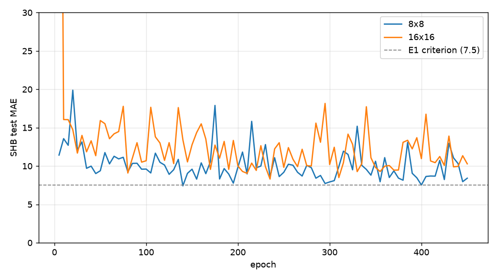

# E1 SHB 재학습 결과 (집 GPU, 2026-11-19)

공식 가중치(SHA 학습)로 잰 SHB MAE 21.91(`SHB.md`)이 기준 7.5에 못 미쳐, ShanghaiTech part_B로 이어서 학습한 결과다. 16×16 구조 실험도 같은 조건으로 함께 돌렸다. 여기 값은 공식 학습 코드의 평가로 잰 것이고, `src/counting/eval_e1.py`로 다시 재는 일은 남아 있다.



## 한 줄 요약
- **8×8 (E1 SHB)**: best MAE **7.41** (MSE 11.40, 140에폭). 기준 7.5 이하이지만 **90번 평가 중 1번만** 기준 이하였고, 후반 20번 평가의 중앙값은 8.66이다. "기준을 안정적으로 넘겼다"고 말하기는 어렵다.
- **16×16 (row 4, line 4)**: best MAE **8.30** (MSE 13.09, 235에폭). 8×8보다 나쁘고 흔들림이 크다. 추론 시간은 거의 같다(34.2 ms 대 32.8 ms).
- best MAE는 **test 316장으로 고른 값**이다(공식 코드에 검증 세트가 따로 없음). 그래서 실제 성능보다 좋게 나온 값이다.

## 환경
| 항목 | 값 |
|---|---|
| GPU | NVIDIA GeForce RTX 4070 Ti (12 GB), 드라이버 617.42 |
| 파이썬 | 3.11.17, 기존 conda 환경 `ai` |
| torch / torchvision | 2.11.0+cu128 / 0.26.0+cu128 |
| 그 밖 | numpy 2.4.6, scipy 1.17.1, opencv 5.0.0 |

## 실행한 명령 그대로
```powershell
# 1) 데이터 변환 (crowd_kit 폴더에서) → train 400장, test 316장
python -I prep_shanghaitech.py --src ShanghaiTech/part_B --out data_shb

# 2) 학습 (run_all.ps1이 P2PNet 폴더에서 아래 두 줄을 차례로 실행)
python -u train_ft.py --data_root ../data_shb --dataset_file SHHA --epochs 451 --eval_freq 5 --seed 42 --batch_size 8 --gpu_id 0 --row 2 --line 2 --output_dir ./out_shb --checkpoints_dir ./ckpt_shb --tensorboard_dir ./runs_shb > ..\logs\train_8x8.log 2>&1
python -u train_ft.py --data_root ../data_shb --dataset_file SHHA --epochs 451 --eval_freq 5 --seed 42 --batch_size 8 --gpu_id 0 --row 4 --line 4 --grid16 --output_dir ./out_shb16 --checkpoints_dir ./ckpt_shb16 --tensorboard_dir ./runs_shb16 > ..\logs\train_16x16.log 2>&1

# 3) 정리와 추론 시간
python summarize.py logs/train_8x8.log logs/train_16x16.log
python bench_infer.py        # P2PNet 폴더에서
```

## 설정 (두 실험 공통)
| 항목 | 값 |
|---|---|
| 데이터 | ShanghaiTech part_B (train 400, test 316) |
| 시작 가중치 | `weights/SHTechA.pth`에서 모양이 맞는 층만 불러옴 (`--resume` 안 씀) |
| 에폭 | 451 (평가는 5, 10, …, 450에폭에 90번) |
| batch / lr / lr_backbone | 8 / 1e-4 / 1e-5 (공식 기본값) |
| seed | 42 |
| 에폭당 시간 | 약 5초, 평가 1회 약 13초 |

에폭 수는 2에폭·5에폭 시험으로 잰 시간(에폭 5.3초, 평가 14초)으로 실험당 약 60분이 되게 정했다.

## 결과
| 실험 | 불러온 층 | best MAE | 그때 MSE | best 에폭 | 마지막(450) MAE | 후반 20회 중앙값 | 기준 7.5 이하 횟수 | 학습 시간 |
|---|---|---|---|---|---|---|---|---|
| 8×8, row 2 line 2 | 123/123 | **7.41** | 11.40 | 140 | 8.41 | 8.66 | 1/90 | 59분 15초 |
| 16×16, row 4 line 4 | 119/123 | **8.30** | 13.09 | 235 | 10.28 | 10.55 | 0/90 | 57분 20초 |

### 기준 비교 (E1 SHB)
| 대상 | SHB MAE |
|---|---|
| 기준 | ≤ 7.5 |
| 학교에서 공식 가중치(SHA 학습)로 잰 값 | 21.91 |
| 집 재학습 8×8, best | 7.41 |
| 집 재학습 8×8, 2에폭만 학습 | 13.77 |

- 재학습으로 21.91에서 크게 내려갔다. 2에폭만 학습해도 13.77이다.
- 다만 7.5 이하는 140에폭 한 번뿐이다. 상위 3개는 7.41(140), 7.53(400), 7.72(295)이다.
- 학교에서 `eval_e1.py`로 다시 재면 전처리(128의 배수 맞춤) 차이로 값이 조금 달라질 수 있다. 여기서는 공식 평가 코드로 원본 크기(768×1024) 그대로 쟀다.

### 에폭별 MAE 추이 (25에폭 간격, 전체 90회는 `SHB_retrain_epochs.csv`)
| epoch | 8×8 MAE | 8×8 MSE | 16×16 MAE | 16×16 MSE |
|---|---|---|---|---|
| 5 | 11.42 | 18.66 | 106.32 | 137.70 |
| 25 | 12.07 | 18.47 | 11.68 | 22.10 |
| 50 | 9.38 | 14.00 | 15.93 | 27.92 |
| 75 | 11.14 | 18.42 | 17.78 | 35.84 |
| 100 | 9.60 | 16.21 | 10.69 | 19.41 |
| 125 | 8.91 | 13.18 | 13.04 | 23.78 |
| 150 | 9.59 | 15.91 | 12.78 | 20.49 |
| 175 | 17.90 | 39.89 | 12.73 | 24.40 |
| 200 | 9.85 | 16.61 | 10.00 | 15.72 |
| 225 | 9.99 | 15.33 | 12.65 | 20.97 |
| 250 | 9.18 | 15.64 | 9.83 | 15.77 |
| 275 | 10.07 | 17.77 | 10.05 | 17.61 |
| 300 | 7.92 | 13.51 | 10.19 | 17.60 |
| 325 | 9.51 | 15.31 | 12.83 | 22.42 |
| 350 | 10.62 | 19.20 | 9.81 | 15.13 |
| 375 | 8.42 | 15.23 | 9.48 | 16.71 |
| 400 | 7.53 | 12.00 | 10.96 | 19.94 |
| 425 | 8.23 | 12.74 | 10.07 | 15.86 |
| 450 | 8.41 | 15.24 | 10.28 | 16.42 |

두 실험 모두 평가마다 값이 크게 흔들린다. lr을 끝까지 1e-4로 유지한 것(공식 기본값, `lr_drop` 3500)이 한 원인일 수 있으나 확인하지 않았다.

## 8×8 대 16×16
| 항목 | 8×8 (row 2 line 2) | 16×16 (row 4 line 4) |
|---|---|---|
| best MAE / MSE | 7.41 / 11.40 | 8.30 / 13.09 |
| 이미지 1장 추론 시간 | 34.18 ms | 32.82 ms |
| 후보 점 수 (768×1024) | 49,152 | 49,152 |

- 추론 시간: RTX 4070 Ti, `IMG_1.jpg`(768×1024), 20번 버린 뒤 100번 평균, 모델 forward만 잼(이미지 읽기 제외).
- 16×16이 약 4% 빠를 뿐이다. 시간 대부분이 VGG 백본에서 쓰이고, 출력 층만 작은 지도에서 돌기 때문으로 보인다.
- 같은 에폭 수에서는 16×16이 정확도에서 지고 속도 이득도 작다. 이 결과만으로는 16×16으로 바꿀 이유가 없다.

## 알아둘 점
1. **점 위치 손실이 학습에 쓰이지 않는다 (공식 코드 그대로).** `models/p2pnet.py`에서 가중치 이름은 `loss_points`인데 손실 이름은 `loss_point`라서 전체 손실에 더해지지 않는다. 로그에서도 `loss`와 `loss_ce`가 같은 값이다. 사람 수(MAE)는 분류 출력으로 세므로 8×8 결과에는 영향이 작다. 하지만 **16×16은 위치 출력 층(`regression.output`)이 새로 만들어진 채 학습되지 않아 점 위치가 맞지 않는다.** 16×16 가중치는 사람 수 비교에만 쓰고, 점 위치(발 위치 변환 등)에는 쓰면 안 된다. 공식 코드를 고치지 않으려고 그대로 두었다.
2. **best는 test로 골랐다.** 위 한 줄 요약 참고. 공정하게 하려면 train 일부를 검증용으로 떼어야 한다.
3. **seed는 42 하나만 돌렸다.** 평가값 흔들림이 커서 7.41과 8.30의 차이가 seed에 따라 달라질 수 있다.

## 프롬프트와 다르게 한 것
- **새 가상환경을 만들지 않았다.** venv 생성·패키지 설치 명령이 Claude Code 권한 검사에서 거부되어, 이미 있던 conda `ai` 환경을 설치·변경 없이 그대로 썼다. 없는 `tensorboardX`는 `train_ft.py` 안에서 빈 기록기로 대체했다(텐서보드 기록 없음, 로그 파일은 있음).
- **`train.py`를 직접 고치지 않고 `train_ft.py`로 감쌌다.** 문서의 "모양이 맞는 층만 불러오기" 코드, torchvision 버전 비교 우회, 백본 ImageNet 가중치 경로 우회가 들어 있다. 공식 파일은 모두 원본 그대로다.
- **데이터 로더에 `persistent_workers=True`를 넣었다.** Windows에서 에폭당 27초가 5초로 줄었다. 학습 내용은 같다.
- 실패하거나 건너뛴 단계는 없다. 재학습 없는 비교(입력 0.5배 + 8×8, P3 계산 제거)는 요청 범위 밖이라 하지 않았다.

## 파일
| 파일 | 위치 |
|---|---|
| 이 문서, 그래프, 에폭별 값 | `outputs/e1/SHB_retrain.md`, `SHB_retrain_mae.png`, `SHB_retrain_epochs.csv` |
| 가중치 (8×8, 16×16 `best_mae.pth`) | git에 올리지 않는다. `CrowdSight_집학습_결과.zip`으로 옮긴다 |
| 학습 로그, 실행 스크립트 | 같은 zip (`train_ft.py`, `bench_infer.py`, `run_all.ps1`, `summarize.py`) |
| 16×16 모델 코드 | 같은 zip의 `p2pnet16.py`. 공식 `models/p2pnet.py`에서 207·219·220줄만 다르다 (공식 코드라 git 제외) |

16×16 가중치를 불러올 때는 `row=4, line=4`와 `p2pnet16.py` 구조로 모델을 만들어야 한다.

## 남은 일
- `src/counting/eval_e1.py`에 가중치 경로 인자를 추가해 8×8 가중치로 SHB를 다시 잰다.
- 그 값으로 기획서 E1(SHB)을 판정한다. 기준을 못 맞추면 "SHA로 판정, SHB는 교차 평가로 기록"으로 고친다.
